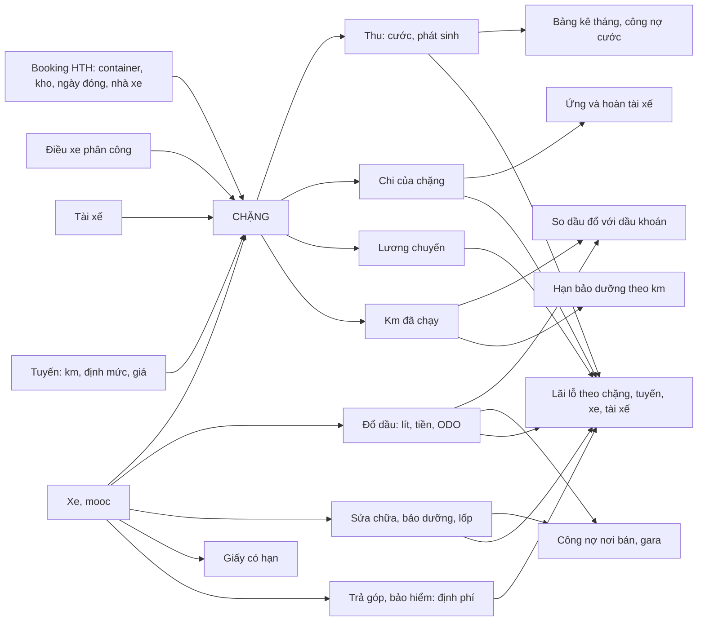

# Đội xe: bản đồ dữ liệu và kiến trúc (ĐỀ XUẤT)

Trạng thái: **ĐỀ XUẤT** (Claude, 19/11/2026), chưa ai chốt. Viết sau khi người dùng nêu ngày 19/11/2026: không mang nguyên luồng và cách làm của Sheet lên web, vì như vậy thà dùng Sheet; phải hiểu toàn bộ dữ liệu nhà xe, mối liên hệ, cách quản lý và tác động tạo ra được. Tài liệu này không thay [`CHI-PHI-XE-01`](decisions/chi-phi-xe-01.md) hay [`DOI-XE-THU-01`](decisions/doi-xe-thu-01.md); điểm nào đổi hướng thì nằm ở mục [Cần người dùng chốt](#cần-người-dùng-chốt).

## Kết luận ngắn

1. Dữ liệu nhà xe đang nằm ở 10 nguồn, khoảng 80 tab. Bên dưới chỉ có **8 loại sự việc** và **5 danh mục**. Phần còn lại là bảng tính lại hoặc bản chép.
2. Cùng một chuyến đang được gõ lại ở tới 7 nơi, mỗi nơi một kiểu ghi biển số và ngày. Vì vậy các sổ không nối được với nhau: riêng tháng 3/2026, bốn nơi cho bốn số chuyến khác nhau.
3. Web không nên có một màn cho mỗi Sheet. Web nên có **một dòng cho mỗi sự việc**, ghi một lần tại nơi nó sinh ra; mọi bảng còn lại là góc nhìn do máy tính.
4. Xương sống là **chặng**: sinh ra từ booking của HTH, điều xe chỉ phân công xe và tài xế. Tiền, dầu, km, lương đều gắn vào chặng hoặc vào xe.
5. Chỗ tạo tác động, xếp theo cỡ tiền: dầu, hiệu suất từng xe, lãi theo tuyến, phí nâng hạ, giấy tờ quá hạn. Bốn khoản đầu cùng thiếu một thứ: các sổ chưa nối được với nhau.

## Doanh nghiệp vận hành thế nào

Đội xe là công ty con, kéo container từ kho đóng hàng ở các tỉnh về cảng, chủ yếu cho HTH (cột công ty của bảng chuyến có 4 tên). Ngoài chặng chở hàng còn chặng phụ: chuyển cảng, trả rỗng, rút mooc, thả mooc. Một phần chuyến do xe thuê ngoài chạy.

Một lô hàng đi qua các bước sau, mỗi bước hiện là một file:

| Bước | Ai làm | Hiện ghi ở |
| --- | --- | --- |
| HTH nhận booking, chọn nhà xe | Chứng từ HTH | Sheet booking (tab tháng, có cột nhà xe) |
| Phân xe, tài xế; lấy seal; đóng phí cảng | Điều xe, người đi lệnh | File điều xe (tab tháng) |
| Chạy chặng, chi tiền dọc đường | Tài xế | Phiếu chi giấy, ảnh gửi về |
| Nhập chi phí, ứng và hoàn tiền | Hai nhân viên | Sheet chi phí tài xế; file BK (bản trùng) |
| Tính cước, lập bảng kê gửi HTH | Kế toán | File công nợ cảng |
| Đổ dầu, trả tiền nơi bán | Tài xế, kế toán | Sheet dầu |
| Sửa chữa, thay nhớt, lốp | Người theo dõi xe | Sheet sửa chữa |
| Giữ và gia hạn giấy tờ | Văn phòng | Sheet hồ sơ giấy tờ |
| Tính lãi lỗ | Chưa có người làm đều | File lợi nhuận (làm tay một lần cho tháng 9) |

## Kiểm kê nguồn (đo 18–19/11/2026, chỉ đọc)

| Nguồn | Sổ gốc nhập tay | Danh mục | Bảng tính lại hoặc bản chép |
| --- | --- | --- | --- |
| Sheet booking HTH | Tab tháng: mỗi container một dòng, cột nhà xe điền đủ ở tháng 10 | | |
| File điều xe (9 tab) | 6 tab tháng: chuyến, seal, 5 cột phí cảng | Xe, tài xế, mooc; lịch nghỉ | 1 tab kéo từ sheet booking |
| Sheet chi phí tài xế | Mỗi tài xế một tab, 29 cột | | |
| File BK (9 tab tháng) | | | Bản riêng một nhóm xe, trùng sheet chi phí |
| File công nợ cảng | Mỗi tháng một file cho mỗi bên: chặng, cước, phát sinh | | |
| Sheet dầu (18 tab) | Sổ mua dầu 1.635 lần đổ; 282 lần trả tiền; sổ dầu khoán mới từ 26/10 | 5 tài khoản dầu; định mức; khu vực kho | 7 tab tính lại; 1 bảng chuyến chép từ file điều xe (846 dòng); 2 sổ của bản thiết kế cũ còn để ẩn |
| Sheet sửa chữa (8 tab) | Sổ sửa chữa 226 dòng | Hạng mục, đơn vị | 4 tab tính lại; 2 tab kéo từ file khác |
| Sheet hồ sơ giấy tờ (10 tab) | Cà vẹt, đăng kiểm, giấy ngân hàng, bảo hiểm | 64 phương tiện | 5 tab tính lại |
| File lợi nhuận tháng 9 (7 tab) | | Bảng giả định: 10 tham số, 19 tuyến | 196 chuyến; đối chiếu dầu, VETC |
| Bảng chuyến có cước và lương | 1.445 chuyến, có lương chuyến | | Claude chưa có quyền đọc file gốc, chỉ thấy bản kéo sang sheet sửa chữa |

Ba nhận xét:

- **Sổ gốc ít, bảng tính lại nhiều.** Phần "thông minh" của các Sheet (cảnh báo hạn, khoán dầu, tổng hợp) đã được dựng bằng công thức. Đây là yêu cầu thật của người dùng, nên đọc chúng như bản mô tả báo cáo cần có, không phải như cấu trúc cần chép.
- **Chuyến không có sổ gốc.** Nó được chép từ file này sang file kia rồi sửa tiếp ở từng nơi.
- **Ba chỗ đã hỏng mà không ai hay:** cột đầu sổ sửa chữa báo lỗi công thức; khoảng 4 trên 10 dòng sửa chữa chưa có tiền; ô ODO trống ở mọi lần đổ dầu cũ.

## Tám loại sự việc, năm danh mục

Mọi tab ở trên quy về các dòng sau. Cột cuối là hiện trạng trên web (schema `doixe`).

| Sự việc | Sinh ra khi | Người biết rõ nhất | Web hiện có |
| --- | --- | --- | --- |
| **Chặng** (một xe kéo một container từ A tới B) | Booking có nhà xe; điều xe phân công | Điều xe | Có `chang`, nhưng sinh ra từ dòng chi phí được dán |
| **Khoản chi của chặng** | Tài xế hoặc người đi lệnh trả tiền | Người trả, có phiếu | Có (`dong`, `dong_phi`) |
| **Khoản thu của chặng** | Chặng hoàn tất; có phát sinh | Kế toán | Có cước theo bảng giá; phát sinh đọc từ ghi chú chữ |
| **Tiền chuyển** (ứng, hoàn, trả nơi bán, tiền cước về, trả góp) | Có chuyển khoản | Kế toán | Có ứng, hoàn, tiền cước về; chưa có nơi bán, ngân hàng |
| **Lần đổ dầu** (lít, tiền, nơi bán, ODO) | Xe đổ dầu | Tài xế, nơi bán | Chưa |
| **Số đo** (ODO, giờ máy phát) | Tài xế chụp đồng hồ | Tài xế | Có ô km, giờ máy trên chặng; chưa có ODO |
| **Việc trên xe** (sửa chữa, bảo dưỡng, lốp) | Xe vào xưởng | Kỹ thuật | Chưa |
| **Giấy có hạn** (đăng kiểm, bảo hiểm, giấy ngân hàng, cà vẹt) | Cấp mới, gia hạn | Văn phòng | Chưa |

| Danh mục | Dùng cho | Web hiện có |
| --- | --- | --- |
| **Phương tiện**: đầu kéo, mooc, chủ đứng tên, đang dùng hay không | Mọi sự việc | Có `xe`: biển số, nhóm, thuê ngoài; chưa phân loại, chưa có mooc và chủ đứng tên |
| **Người**: tài xế, người đi lệnh | Chặng, tiền | Có `nguoi`: tên, vai |
| **Tuyến**: km, định mức dầu, phí đường chuẩn, số ngày xe | Thu, lương, dầu, lãi lỗ | Có `tuyen` cho giá cước; chưa có km, định mức |
| **Đối tác**: bên trả cước, nơi bán dầu, gara, ngân hàng, bảo hiểm, nhà xe ngoài | Công nợ | Có `ben` (bên trả cước) |
| **Bảng mức có ngày áp dụng**: giá cước, lương chuyến, định mức dầu, mức phí | Máy tự tính | Có giá cước, mức phát sinh |

## Mối liên hệ

Năm khóa nối mọi thứ: **xe, người, chặng, tuyến, số đo theo thời gian (ngày, ODO)**. Hôm nay mỗi Sheet tự gõ lại năm khóa này theo kiểu riêng. Số đo trên dữ liệu thật:

- **Phương tiện:** hồ sơ giấy tờ có 64 phương tiện (21 đầu kéo, 43 mooc) dưới 11 tên chủ đứng tên. Sổ dầu biết 20 biển, bảng chuyến 26 biển, sổ sửa chữa 45 biển: mỗi sổ một danh sách riêng. Biển số có nơi chỉ ghi 4–5 số cuối.
- **Tài xế với xe gần như cố định:** trong 483 chuyến tháng 8–10/2026, cả 24 tài xế chỉ lái một xe; 20 trên 22 xe chỉ có một tài xế. Vậy "tài xế đang chạy xe nào" là danh mục có ngày đổi, không cần gõ ở từng chuyến.
- **Một container có nhiều chặng, nhiều xe** (đã đo ở [spec đợt 1](../specs/chi-phi-xe-01.md)): gán xe theo chặng, không theo container.
- **Dầu với chuyến chưa nối được:** 12 trên 53 lượt xe-tháng có chuyến mà không có lần đổ nào trong sổ dầu (chưa tách xe ngoài); km chỉ là ước theo tuyến vì không có ODO. Sổ dầu khoán mới (từ 26/10) đã bắt đầu ghi ODO mỗi lần chụp đồng hồ: đây là số đo còn thiếu.
- **Bảo dưỡng phụ thuộc km:** bảng theo dõi nhớt lấy km từ bảng chuyến và ODO, nên thiếu ODO thì phải ước.

## Vì sao chép nguyên Sheet thì tệ hơn Sheet

Sheet chịu được việc gõ lại, sửa tự do và công thức tự dựng. Web cứng hơn: chép cả luồng sang thì giữ nguyên nhược điểm mà mất sự linh hoạt. Phần đã lên `hao` còn các dấu vết sau của Sheet:

| Dấu vết | Ở đâu | Hệ quả | Hướng đổi |
| --- | --- | --- | --- |
| Chặng sinh ra khi có người dán dòng chi phí | Mặc định 1 của đợt 1 | Chặng chưa có phí thì web không biết là có chặng; điều xe vẫn phải giữ file riêng | Chặng sinh từ booking và phân công |
| Dán khối 29 cột là đường nhập chính | Màn sổ người | Web đi sau Sheet, Sheet vẫn là nơi nhập | Dán chỉ còn là cầu chuyển dữ liệu cũ |
| Vị trí cột Sheet nằm trong danh mục phí | `loai_phi.cot_sheet` | Sheet đổi cột là phải sửa cơ sở dữ liệu | Đưa bảng ánh xạ cột về công cụ chuyển dữ liệu |
| Khoản thu phát sinh viết trong ghi chú chữ | Bộ đọc ghi chú của đợt 2 | Gõ sai một ký tự là sai tiền hoặc bị gắn cờ | Mỗi khoản một dòng: chọn loại, nhập số lượng, máy nhân mức |
| Nơi lấy, nơi hạ, tỉnh, kho, tên hàng là chữ tự do | `chang` | Không gom được theo tuyến | Chọn tuyến chuẩn; kho và hàng lấy từ booking |
| Màn chia theo tháng và theo người như tab | Sổ người, sổ xe | Hợp để quyết toán, không hợp để điều hành hằng ngày | Thêm góc nhìn theo ngày và theo việc đang dở |

Giữ nguyên: file Excel bảng kê 19 cột. Đó là chứng từ gửi đi, không phải cách nhập.

## Nguyên tắc kiến trúc

1. **Mỗi sự việc ghi một lần**, tại nơi nó sinh ra, bởi người biết rõ nhất.
2. **Danh mục dùng chung, chọn chứ không gõ:** xe, người, tuyến, đối tác.
3. **Chặng là xương sống.** Chặng hàng sinh từ booking có nhà xe là đội xe; chặng phụ do điều xe thêm. Mọi khoản tiền và số đo gắn vào chặng hoặc vào xe.
4. **Tách "ai nợ ai" khỏi "tiền đã chuyển".** Một cơ chế công nợ chung cho mọi đối tác: bên trả cước, tài xế, nơi bán dầu, gara, ngân hàng. Cơ chế này đã có ở sổ khách, ứng và hoàn, bảng kê và tiền về.
5. **Quy tắc là dữ liệu có ngày áp dụng.** Máy tính số "nên là" (cước, lương chuyến, dầu khoán, phí đường chuẩn); người chỉ xử lý chỗ thực tế lệch khỏi chuẩn.
6. **Không ai gõ số tổng.** Lãi lỗ, công nợ, hạn giấy tờ, hạn bảo dưỡng đều là góc nhìn tính lại được từ dòng gốc.
7. **Mỗi dòng có trạng thái; việc dở thành hàng chờ:** chặng chưa phân xe, chưa có phí, chưa có giá; lần đổ dầu vượt khoán; giấy sắp hết hạn; nợ sát hạn mức. Người dùng xử lý hàng chờ thay vì soát cả bảng (cách hộp Việc cần làm của sổ nợ đang làm).
8. **Sheet cũ chỉ còn hai vai:** nguồn chuyển dữ liệu một lần và đối chiếu trong tháng chạy song song.

## Tác động: dữ liệu trả lời câu hỏi nào

Tỷ lệ dưới đây lấy từ file lợi nhuận tháng 9/2026 của chính nhà xe (theo giả định của họ) và các sổ gốc; số tiền nằm ngoài Git.

| Câu hỏi quản lý | Cỡ vấn đề | Cần nối dữ liệu nào | Hiện thiếu |
| --- | --- | --- | --- |
| Xe nào đổ dầu nhiều hơn mức đáng lẽ? | Dầu là khoản chi lớn nhất, khoảng 2/5 doanh thu. Thực đổ so với khoán lệch từ thấp hơn nhiều tới cao hơn gần 1/5 tùy xe. Chính mô hình của nhà xe cho thấy siết định mức làm lãi tháng tăng hơn gấp đôi | Lần đổ dầu + ODO + km chặng + định mức theo tuyến | ODO; chặng và dầu chung một danh sách xe |
| Xe nào đang nằm, vì sao? | Tháng 8–10: mỗi xe chạy từ 2 tới 21 chuyến một tháng; nửa số xe làm ra gần 4/5 cước. Định phí (lãi vay là chính) tính theo ngày, xe nằm vẫn tốn | Chặng theo ngày + lịch nghỉ + ngày xe ở xưởng | Chặng có trạng thái theo ngày; lý do xe nằm |
| Tuyến nào lỗ, cước hòa vốn bao nhiêu? | Lãi cả tháng mỏng, một chữ số phần trăm. Chuyển cảng chiếm hơn 1/3 số chuyến và lỗ từng chuyến theo mô hình; vài tuyến gần cũng lỗ | Thu + chi chặng + dầu khoán + định phí theo ngày xe | Chi phí thật thay cho giả định; số ngày xe của từng chặng |
| Phí nâng hạ có đúng mức, khoản chi hộ có đòi lại đủ? | Phí cảng và nâng hạ khoảng 1/5 doanh thu. Xí cont và cont mới chỉ khớp một phần giữa số thu và số chi (đo ở [spec đợt 2](../specs/doi-xe-thu-01.md)) | Chi của chặng (cả phần người đi lệnh trả) + thu của chặng | Phí cảng của file điều xe chưa lên web |
| Giấy nào sắp hết hạn? | 17 giấy đã quá hạn, 6 giấy còn tối đa 30 ngày (đo 18/11/2026) | Giấy có hạn + phương tiện | Chưa có trên web |
| Tuần này phải trả ai, sẽ thu gì? | Nơi bán dầu có hạn mức; ba tài khoản đã ngưng còn số nợ chưa đối chiếu; trả góp chưa có lịch | Công nợ mọi đối tác + lịch trả góp | Nơi bán, gara, ngân hàng |
| Lương chuyến tháng này của từng tài xế? | Lương chuyến gần 1/10 doanh thu | Chặng + bảng mức lương theo tuyến | Bảng mức lương |

Ba khoản đầu là nơi tiền nằm. Cả ba cần cùng một nền: chặng đủ và đúng, xe và tuyến chuẩn, ODO.

## Khối chức năng và thứ tự đề xuất

| Thứ tự | Khối | Thay cho | Ra được gì ngay |
| --- | --- | --- | --- |
| 1 | **Trục chung:** phương tiện (cả mooc, chủ đứng tên), người, tuyến (km, định mức), đối tác. Kèm **giấy có hạn** | Hai danh sách xe, sheet hồ sơ giấy tờ | Danh sách giấy quá hạn và sắp hết hạn; hết gõ biển số |
| 2 | **Điều độ:** chặng hàng sinh từ booking, điều xe phân công, thêm chặng phụ, trạng thái theo ngày | Phần chuyến của file điều xe; các bảng chuyến chép lại | Hết gõ lại chuyến; biết xe nào đang nằm |
| 3 | **Dầu và số đo:** lần đổ dầu, ODO, giờ máy phát, dầu khoán, công nợ nơi bán | Sheet dầu | Lít trên 100 km từng xe, lần đổ vượt khoán |
| 4 | **Lãi lỗ bản đầu:** thu − chi chặng − dầu − lương chuyến, theo chặng, tuyến, xe | File lợi nhuận làm tay | Tuyến lỗ, xe lỗ, bằng số thật |
| 5 | **Việc trên xe và định phí:** sửa chữa, lốp, bảo dưỡng theo km; trả góp, bảo hiểm; lương | Sheet sửa chữa; phần còn thiếu của lãi lỗ | Lãi lỗ đủ; hạn bảo dưỡng; dòng tiền phải trả |

Khác với phân kỳ cũ ở [spec đợt 1](../specs/chi-phi-xe-01.md#phân-kỳ): "đợt 3" được tách ra và xếp lại, trục chung và điều độ đi trước vì mọi khối sau cần chúng.

## Phần đã lên `hao`: giữ gì, đổi gì

- **Giữ:** chặng, dòng phí chuẩn hóa, ứng và hoàn, khóa tháng, Lịch sử, chống ghi trùng lệnh; bảng giá có ngày áp dụng; bảng kê, điều chỉnh, tiền về. Các phần này đúng với nguyên tắc 3, 4, 5.
- **Đổi dần, không gỡ ngay:** sáu dấu vết ở mục trên. Thứ tự hợp lý là làm khối 1 và 2 trước, rồi chuyển đường nhập chi phí sang "chọn chặng có sẵn rồi ghi tiền".
- **Dữ liệu bản thử tháng 10–11** vẫn dùng được: chặng đã nạp sẽ được nối vào booking theo container như hiện nay.

## Cần người dùng chốt

1. Có lấy **chặng sinh từ booking, điều xe phân công trên web** làm xương sống không? Việc này đổi mặc định 1 của đợt 1 và cần điều xe làm trên web hằng ngày. Web phải đọc thêm cột nhà xe của sheet booking.
2. Có đồng ý **thứ tự 5 khối** ở trên không, hay vẫn ưu tiên phần khác?
3. **Phạm vi "nhà xe":** chỉ đội xe của công ty con, hay gồm cả công nợ phải trả các nhà xe ngoài mà HTH thuê (tháng 10 cột nhà xe của booking có 11 giá trị)? Hai việc này dùng chung danh mục nhưng là hai bài toán khác nhau.
4. **Ai ghi tại nguồn:** đợt đầu văn phòng nhập thay tài xế như hiện nay; về sau tài xế có gửi ảnh ODO và phiếu chi qua điện thoại không?
5. **Nguồn còn thiếu:** quyền đọc file bảng chuyến có cước và lương; bảng mức lương chuyến; lịch trả góp từng xe (trùng câu 8, 9 của spec đợt 1).
6. **Bản đang chạy thử:** hai nhân viên tiếp tục nhập thử theo luồng hiện tại tới khi khối 2 xong, hay tạm dừng để khỏi quen luồng sẽ đổi?

## Bằng chứng và giới hạn

- Đọc ngày 18–19/11/2026, chỉ đọc, không ghi Sheet, cơ sở dữ liệu hay `hao`: bản xuất của 9 nguồn ở bảng kiểm kê (riêng file bảng chuyến có cước chỉ đọc qua bản kéo sang), schema `doixe` trong `cong-no-web-handoff/tools/migrations/2026-11-18-v7-doi-xe*.sql`, hai spec và hai quyết định của Đội xe.
- Số đếm và tỷ lệ đo bằng script đọc file; bản xuất và script nằm ngoài Git. Số tiền không đưa vào repo.
- Bảng chuyến tháng 4–7/2026 thiếu nhiều (đo 18/11/2026), nên số đo hiệu suất chỉ lấy tháng 8–10.
- Km là km ước theo tuyến, chưa phải ODO; tỷ lệ lít trên 100 km vì vậy chỉ cho biết cỡ vấn đề.
- Tỷ lệ chi phí lấy từ mô hình tháng 9 của nhà xe, trong đó nâng hạ, lãi vay, sửa chữa là số giả định của họ.
- Chưa mở màn Đội xe trên `hao` và chưa hỏi điều xe, hai nhân viên, kế toán. Nhận xét về luồng dựa trên spec và schema.
