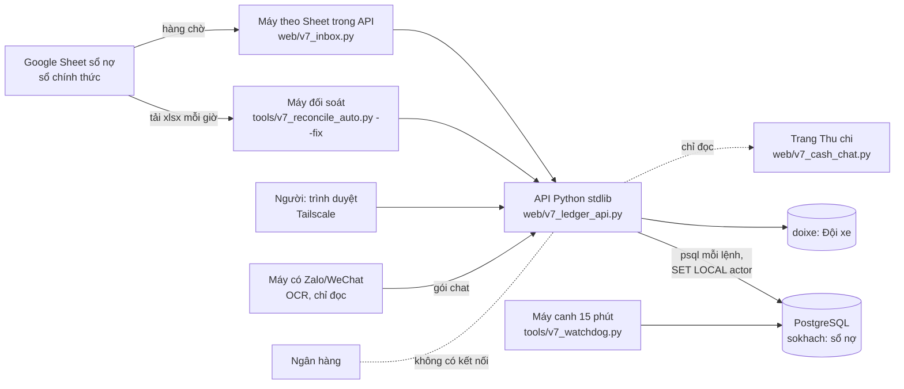

# A. Audit hệ thống hiện tại (Current System Audit)

Trạng thái: **bằng chứng đọc mã** trên `main` tại `3c75c094` (24/11/2026), dùng cho blueprint v3.0. Chỉ đọc repo; không đọc DB thật, không đăng nhập `hao`, không chạy lệnh ghi. Số đo dữ liệu thật dẫn lại từ đề xuất THU-CHI-02 (đo chỉ đọc 24/11/2026, chỉ số đếm).

[← Mục lục](README.md) · Quy trình: [B](B-quy-trinh-as-is-to-be.md) · Gap: [C](C-gap-analysis.md)

Nhãn: **Quan sát** (observed — thấy trong mã/tài liệu, có file:dòng) · **Suy luận** (inferred — rút ra từ quan sát) · **Đề xuất** (proposed — ở các file C–I). Mọi dòng trong file này là quan sát, trừ chỗ ghi *Suy luận*.

Viết tắt: `schema:` = `cong-no-web-handoff/schema/v7_schema_current.pgsql` (định nghĩa hiện hành, sinh tự động); đường dẫn khác tính từ `cong-no-web-handoff/`, trừ `docs/`, `specs/`, `scripts/`, `.github/`.

## 1. Phạm vi và cách làm

Đọc: schema `sokhach` (bản chụp hiện hành), migration `doixe`, các module `web/` có đường ghi tiền, quyền, danh tính, máy ghi theo Sheet, máy canh, harness PostgreSQL, quy trình triển khai, sổ quyết định. Mỗi khẳng định có file:dòng; chỗ không thấy ghi "không có". Không đánh giá giao diện.

## 2. Kiến trúc hiện tại

- Một máy chủ `hao`, truy cập qua Tailscale; API Python thư viện chuẩn gọi `psql` cho mỗi lệnh với `BEGIN; SET LOCAL sokhach.actor = …; SELECT <hàm>; COMMIT` (`web/v7_psql.py:207-212`), giới hạn 15 giây câu lệnh, 12 giây khóa (`web/v7_psql.py:214`).
- Sổ nợ chính thức vẫn là Sheet; web chạy song song và tự đi theo Sheet ([`SONG-SONG-01`](../../docs/decisions/song-song-01.md), [`CHUYEN-HAN-01`](../../docs/decisions/chuyen-han-01.md), [`MAY-DOI-SOAT-01`](../../docs/decisions/may-doi-soat-01.md)).
- **Không có kết nối nào với ngân hàng**, không có bảng giao dịch ngân hàng, tài khoản, tiền tệ hay pháp nhân (tìm `ty_gia`, `tai_khoan`, `phap_nhan`, `currency` trong `web/`, `tools/`, `preview/`: không có cột hay bảng tương ứng).

## 3. Sổ nợ phải thu `sokhach`

### 3.1 Dữ liệu

| Bảng | Vai trò | Bằng chứng |
| --- | --- | --- |
| `customer` | Một sổ khách = đơn vị khóa và phiên bản lệnh ghi; không có cột pháp nhân | `schema:173-191` |
| `trip` (+ `trip_info_rev`, `trip_price_rev`, `trip_fee_line`) | Chuyến chỉ thêm; `container`, `booking` là chữ, **container không phải khóa duy nhất**; trạng thái `confirmed`/`pending_review`/`rejected`; sửa bằng bản sửa đổi; chặn đưa chuyến sang sổ khác | `schema:720-759` |
| `receipt` | Phiếu thu: `amount_vnd bigint > 0`, hình thức `THU TIỀN`/`CẤN TRỪ`/`ỨNG TRƯỚC`/`KHÁC`, `reference` chữ tự do không bắt buộc, hủy có lý do, `pid` do server cấp | `schema:605-647` |
| `receipt_line` | Dòng phân bổ theo **tháng nợ** (`debt`/`advance`), có phiên bản bằng `superseded_by_event` | `schema:676-701` |
| `receipt_image` | Ảnh chứng từ (≤ 2 MB, SHA-256), gỡ có lý do; ảnh không chứng minh tiền đã về ([`CHUNG-TU-01`](../../docs/decisions/chung-tu-01.md)) | `schema:649-674` |
| `event` | Vết chỉ thêm, `before`/`after` bắt buộc, CHECK nội dung tối thiểu theo 29 loại | `schema:278-343` |
| `idempotency` | (khách, khóa) + SHA-256 nội dung + kết quả; bất biến | `schema:381-395` |
| `month_state` | Ổ khóa từng tháng; thiếu dòng thì chỉ tháng hiện tại (giờ VN) mở; cập nhật tại chỗ nhưng mỗi lần đổi có event trước | `schema:455-469`, `schema:6296-6304` |
| `opening_balance` | Số dư đầu theo khách × tháng tại mốc chuyển, bất biến | `schema:518-541` |
| `v_outstanding_month` | Nợ còn lại từng tháng: phần dư của tháng âm cấn vào tháng nợ cũ nhất, phần còn dư nằm ở tháng cuối ([`CAN-DU-01`](../../docs/decisions/can-du-01.md)) | `schema:922-944` |
| `offset_command`, `offset_pair` | Cấn trừ hai sổ trong một lệnh | `schema:471-516` |

Không có: tài khoản ngân hàng, giao dịch ngân hàng, tiền tệ khác VND, pháp nhân, hóa đơn/debit note như đối tượng sổ, tiền chưa rõ chủ (theo [`V7-CSM`](../../docs/decisions/v7-csm.md) (1)).

### 3.2 Đường ghi và bất biến

- **Khuôn lệnh:** `_begin_command` lấy người làm từ biến phiên (`_actor`, `schema:1084-1096`), khóa dòng khách `FOR NO KEY UPDATE`, kiểm khóa lặp (cùng băm trả kết quả cũ, khác băm `IDEMPOTENCY_CONFLICT`), rồi kiểm phiên bản (`STALE_LEDGER`) (`schema:1116-1142`). `_finish_command` tăng phiên bản và lưu kết quả (`schema:1971-1987`).
- **Ghi phiếu thu** (`record_receipt`, `schema:5705-5780`): chặn ngày tương lai theo giờ VN (`schema:5723-5724`); phân bổ nợ cũ trước trên `v_outstanding_month_raw`, phần dư thành dòng `advance` ở tháng cuối (`schema:5737-5751`); ghi event có bộ phân bổ (`schema:5756-5760`); rồi **tính lại phân bổ mọi phiếu chưa hủy** theo (ngày, mã phiếu), chỉ ghi lại phiếu có phân bổ đổi (`schema:5770`, `schema:5508`); trả cờ `duplicate_reference` chỉ để cảnh báo (`schema:5773-5775`).
- **Phân bổ lại** (`reallocate`, `schema:5437-5536`): tính lại toàn bộ; phiếu nào có phân bổ đổi thì đóng dòng cũ bằng event `reallocation` và ghi bộ mới (`schema:5508-5526`); cuối lệnh gọi `_check_allocations`.
- **Bất biến phân bổ** (`_check_allocations`, `schema:1649-1697`): phiếu sống có Σ dòng hiện hành = số phiếu; phiếu hủy không còn dòng hiện hành; `advance` chỉ ở tháng cuối; mỗi dòng truy được về event tạo và event thay.
- **Hủy phiếu** (`void_receipt`, `schema:6498-6540`): bắt buộc lý do, đóng dòng phân bổ, không phân bổ lại phiếu khác.
- **Khóa tháng:** `_month_open` báo `MONTH_LOCKED` trừ khi tháng là tháng hiện tại (giờ VN) hoặc đã mở (`schema:2330-2347`). Ghi phiếu thu **không** gọi kiểm này, đúng quyết định tháng khóa vẫn nhập phiếu ([khóa tháng 24/10](../../docs/decisions/khoa-thang-2026-10-24.md)); sửa chuyến, phụ phí, điều chỉnh ở tháng khóa phải mở trước.
- **Quyền DB:** hàm `SECURITY DEFINER` với `search_path` cố định, `REVOKE ALL FROM PUBLIC`, chỉ cấp EXECUTE cho role app (ví dụ `schema:5778-5780`); không role nào có INSERT/UPDATE/DELETE trên bảng (`tools/test_pg_v7_grants.py:38-206`, `tools/v7_post_deploy_check.sql:43-92`).
- **Chỉ thêm:** 12 bảng gắn trigger `reject_immutable_change` (thân hàm `schema:5803-5810`; trigger ví dụ `schema:337`, `schema:392`, `schema:537`, `schema:750`). `receipt` không xóa được, chỉ hủy hoặc sửa ngày, hình thức, tham chiếu kèm event (`schema:4859-4888`); `receipt_line` chỉ bị thay một lần (`schema:4893-4911`); `receipt_image` (`schema:2067`) và `offset_pair` (`schema:4840`) có guard riêng. Superuser và chủ bảng vẫn vượt được trigger; login nạp dữ liệu là thành viên owner (`docs/v7-deploy-runbook.md:237`).

**Nhận xét kiến trúc.** Phân bổ ở sổ nợ là **kết quả tính lại** (balance-forward theo tháng), không phải phân bổ do người chọn theo hóa đơn. Mọi liên kết từ bên ngoài vào sổ nợ phải trỏ tới phiếu (`customer_id`, `pid`), không trỏ dòng phân bổ (ADR-TIEN-09).

### 3.3 Máy ghi theo Sheet

- Máy đối soát mỗi giờ (`tools/v7_reconcile_auto.py --fix`) gọi `apply_fix` với người làm `AUTO_ACTOR` (`tools/v7_reconcile_auto.py:50-54`, `:278`); `apply_fix` ghi phiếu bằng `record_receipt`, `reference` lấy chữ ghi chú của Sheet (`web/v7_sheet_fix.py:432-438`), hủy phiếu khi Sheet sửa (`:449`), ghi/hủy điều chỉnh (`:458-493`). Khóa lặp gắn phiên bản sổ lúc bắt đầu (`web/v7_sheet_fix.py:426`), nên chống ghi trùng giữa các lượt dựa vào hàng chờ đã ghép.
- Máy theo Sheet trong API khi bật `WEBDEBIT_AUTO_SHEET` (`web/v7_inbox.py:48-69`), tự mở tháng khóa, ghi, khóa lại (`web/v7_inbox.py:134-171`).
- Người làm của máy chỉ phân biệt bằng chữ trong cột `actor` (không có cột loại người làm) (`schema:282`). Khi người bấm sửa từ bảng đối chiếu, lệnh tiền mang tên người nhưng mở/khóa tháng vẫn ghi là máy, có chủ đích (`web/v7_sheet_fix.py:419-421`).

## 4. Phần khác chạm tiền

| Thành phần | Hiện trạng | Bằng chứng |
| --- | --- | --- |
| **Đội xe `doixe`** | Ứng (`ung`, > 0), đợt hoàn (`dot_hoan`, một lần chuyển cho N dòng), tiền về theo bảng kê (`tien_ve`, chặn trả dư), số dư người = đầu kỳ + chi − hoàn − ứng (`doixe._so_du`). Khóa lặp riêng `doixe.lenh` + một khóa advisory chung cho mọi lệnh Đội xe. Hủy bắt buộc lý do. `ung`, `dot_hoan`, `chang`, `dong`, `tien_ve` chỉ chặn DELETE (UPDATE vẫn được); `dong_phi` sửa/xóa tại chỗ ở tháng mở. Khóa tháng riêng `doixe.thang_khoa`. **Không có liên kết ngân hàng** (chỉ `ghi_chu`). Chỉ quản lý (tiền tố `/api/v7/doixe`) | `tools/migrations/2026-11-18-v7-doi-xe.sql:57-88`, `:185-192`, `:280-298`, `:326`; `…-doi-xe-thu.sql:208-228`; `web/v7_role.py:20` |
| **Đề xuất Đội xe B4** | `doi_tac`, `tien_chuyen` cùng khuôn `ung` — **chưa code**; dễ thành sổ tiền thứ hai | [`DOI-XE-MO-HINH-01`](../../docs/decisions/doi-xe-mo-hinh-01.md), `specs/doi-xe-mo-hinh-01.md:192-194` |
| **Trang Thu chi từ chat** | Ghép **một–một** bằng ghép cặp cực đại trên các ứng viên đúng số tiền trong cửa sổ ngày [−3, +7]; nhóm tranh chấp để người chọn; một ứng viên lẻ khác số tiền vẫn hiện thành gợi ý `AMOUNT_DIFF`; CNY không ghép được (sổ chỉ VND). Chỉ ghi `record_cash_review` (bảng review chỉ thêm qua hàm, không có trigger bất biến) | `web/v7_cash_chat.py:41`, `:82-117`, `:556-602`, `:621-622`, `:838`; `tools/migrations/2026-11-21-v7-cash-report-review.sql:7-44` |
| **OCR ảnh tiền Zalo/WeChat** | Không có đường ghi vào sổ; công tắc mặc định tắt (`--money-images`, `--wechat`, `ZALO_AGENT_EXTERNAL` cho Gemini) | `tools/zalo_agent/__main__.py:243-256`, `tools/zalo_agent/gemini.py:145`; [`ZALO-THU-CHI-01`](../../docs/decisions/zalo-thu-chi-01.md) |
| **"Khách báo đã chuyển" — báo thu sẵn có** | `contact_mark` loại `paid_claim`: khách (sổ), số tiền VND, ngày, ghi chú, gắn được tin Zalo, khóa lặp duy nhất, hủy có lý do; trạng thái tính khi đọc (có phiếu cùng số tiền trong [−3, +7] ngày thì `received`, quá +3 ngày thì `not_seen`); không đổi số dư. Thiếu: tiền tệ, tài khoản nhận dự kiến, mục đích/tháng chỉ định | `schema:131-171`, `schema:2314-2318` |
| **Debit note** | Tính tổng và "Payment Ref." ở trình duyệt; số debit note gợi ý `<mã>-<yymm>-001`, **không lưu DB**; bên phát hành mã cứng trong trình duyệt; tài khoản nhận lấy từ cấu hình ngoài repo hoặc bản chụp Thông tin cty, số tài khoản không che | `preview/debit-note-v4.js:156`, `:395`; `preview/so-khach-v7-model.js:987-989`; `preview/so-khach-v7-debit-ui.js:14-27`; `web/v7_debit_note_config.py:60-61` |
| **Telegram** | Tắt mặc định; khi bật gửi chiều, số tiền, tên khách/biển số, link | `web/v7_telegram.py:14-15`, `:92-125`; [`TELEGRAM-01`](../../docs/decisions/telegram-01.md) |
| **Sổ cũ `webdebit_ledger`** | Chỉ một test còn dùng; V7 từ chối DB này; `tools/pg_ledger_schema.sql` còn maker/checker trái [`V6-DB`](../../docs/decisions/v6-db.md) | `web/ledger_db.py:1-16`; `web/v7_psql.py:342-346`; `tools/pg_ledger_schema.sql:93` |

Ngoài web: tiền hàng khách Trung Quốc (USD vào, đổi, chi hộ, ứng) nằm trong Excel và ảnh nhóm WeChat; chi công ty ngoài Đội xe không có sổ; xin duyệt chi bằng tin nhắn (THU-CHI-02, đo 24/11/2026).

## 5. Thành phần tái sử dụng

| Thành phần | Dùng cho sổ tiền thế nào | Bằng chứng |
| --- | --- | --- |
| Khuôn lệnh khóa + băm + phiên bản | Lệnh nhập, phân bổ, ký kỳ (scope = tài khoản) | `schema:1116-1142`, `schema:1971-1987` |
| Event chỉ thêm, CHECK theo loại | `tien.event` cùng khuôn, thêm `actor_kind` | `schema:278-343` |
| Trigger bất biến | Bảng file, lô, dòng gốc, giao dịch | `schema:5803-5810` |
| Kiểm bất biến cuối lệnh | Hàm kiểm Σ phân bổ ≤ số tiền, truy event | `schema:1649-1697` |
| Phân bổ có phiên bản | `allocation.superseded_by_event` | `schema:676-701` |
| `_actor` từ biến phiên, `SECURITY DEFINER`, `search_path` cố định | Giữ nguyên khuôn | `schema:1084-1096` |
| Bộ đọc số nguyên chặt, từ chối số thực/trường lạ | Hợp đồng API sổ tiền | `web/v7_api_validate.py:48-77`, `:144-157` |
| Bảng `ERRORS`, `ADMIN_API_PREFIXES` | Mã lỗi và chặn route | `web/v7_api_tables.py:92-242`; `web/v7_role.py:20-21` |
| Danh tính Tailscale chỉ tin `tailscaled` | Người làm của mọi lệnh | `web/v7_identity.py:304-333` |
| Máy canh + healthchecks | Thêm bất biến sổ tiền | `tools/v7_watchdog.py:269-273`, `:534-544` |
| Harness PostgreSQL dùng một lần, có test đồng thời, quyền, bất biến ngẫu nhiên | Khuôn cho `test_pg_tien_*` | `tools/pg_v7_harness.py:21`; `tools/test_pg_v7_grants.py`; `tools/test_pg_v7_p0_harness.py` |
| Runbook triển khai SQL + kiểm sau triển khai | Migration `tien` | [`DEPLOY-CLAUDE-01`](../../docs/decisions/deploy-claude-01.md); `tools/v7_post_deploy_check.sql` |
| `dot_hoan` (một lần chuyển ↔ nhiều dòng) | Mẫu tham khảo cho phân bổ một–nhiều | `tools/migrations/2026-11-18-v7-doi-xe.sql:73-88` |
| Ghép một–một của trang Thu chi | Chỉ làm tín hiệu R4 (số tiền + ngày) trong luật shadow | `web/v7_cash_chat.py:556-602` |

## 6. Danh tính, quyền, API

- **Danh tính:** chế độ Serve tin header `Tailscale-User-Login` khi kết nối đến từ `tailscaled` (uid 0) trên loopback, và từ các uid chỉ-đọc đã cấu hình (bot Zalo) nhưng chỉ cho GET; còn lại hỏi LocalAPI (`web/v7_identity.py:304-333`, `:312-315`). Danh sách login được vào ([`ACCESS-01`](../../docs/decisions/access-01.md)); thiếu danh sách thì chế độ Serve không khởi động (`web/v7_ledger_api.py:1124-1126`).
- **Vai trò:** chỉ chia màn hình; quyền ghi tiền sổ nợ như nhau cho mọi login được vào; API mới mặc định mở; không đặt danh sách quản lý thì mọi login là quản lý (`web/v7_role.py:5`, `:28-29`, `:40-46`; [`QUYEN-01`](../../docs/decisions/quyen-01.md)). Không có quyền theo sổ.
- **DB:** một login `v7_app` cho mọi người và mọi máy (`docs/v7-deploy-runbook.md:345`; `tools/v7_reconcile_auto.py:616-618`); từ chối chạy bằng `postgres`/superuser (`web/v7_psql.py:340`, `:372-376`).
- **Vệ sinh request:** chỉ GET/POST; POST cần `Origin` đúng và `application/json`, không có token CSRF; `Sec-Fetch-Site` thiếu thì vẫn cho (`web/v7_ledger_api.py:349-354`, `:838-840`). Thân tối đa 64 KiB, ảnh 3 MiB (`web/v7_api_tables.py:12-16`). Số tiền là chuỗi số nguyên; số thực, trường lạ, khóa trùng bị từ chối (`web/v7_api_validate.py:48-77`, `:144-157`).
- **Khóa lặp phía client:** `crypto.randomUUID()`, gửi lại khi `RESULT_UNKNOWN` (`preview/so-khach-v7-api.js:179`, `:258`, `:282`); API chỉ kiểm hình dạng (`web/v7_api_validate.py:165-167`).
- **Log:** mỗi POST ghi method, đường dẫn, mã trả, người làm, thời gian; không ghi thân (`web/v7_ledger_api.py:813-818`).
- **Cờ:** biến môi trường đọc khi dùng; bảng route tĩnh, không có công tắc theo route (`web/v7_api_tables.py:24-89`).

## 7. Vận hành, kiểm thử, frontend

- **Harness PostgreSQL:** 48 file; bản V7 chạy trên PostgreSQL 18.6 dùng một lần, không mạng (`tools/pg_v7_harness.py:21`, `:434`); kiểm tổng phân bổ, khóa lặp, `STALE_LEDGER`, lùi nguyên tử khi tiêm lỗi, đồng thời bằng `pg_blocking_pids`, quyền, `search_path` độc, 12 bất biến sau mỗi lệnh, so FIFO với mô hình tham chiếu bằng Hypothesis. CI chạy mỗi nhóm một job; PR chỉ sửa tài liệu bỏ qua các job PostgreSQL (`.github/workflows/test.yml:42-48`, `:99-252`).
- **Lưới an toàn** ([`LUOI-AN-TOAN-01`](../../docs/decisions/luoi-an-toan-01.md)): mỗi 15 phút, chỉ đọc: `_check_allocations` mọi sổ, Tổng quan = tổng các sổ, sổ không đổi khi không có lệnh (md5 13 bảng tiền), event chỉ thêm, catalog đúng bản phát hành (`schema:4567-4661`; `tools/v7_safety_net.py`).
- **Sao lưu:** mỗi giờ 06–22 giữ 51 bản trên `hao`, hằng ngày giữ 30; bản trên `hao` là `pg_dump -Fc` **không mã hóa**, chọn schema theo danh sách `EXTRA_SCHEMAS` (`tools/v7_backup.py:364-365`); bản mã hóa age được 3 PC kéo về (`docs/v7-deploy-runbook.md:574-590`, `:704-751`, `:819-825`). RPO ≤ 1 giờ khi lỗi ứng dụng; mất đĩa thì về bản 02:40. **RTO chưa có số đo**; khôi phục DB đã diễn tập và chạy trong CI, dựng lại cả máy chưa diễn tập; các PC cùng địa điểm với `hao` (`docs/rebuild-hao.md:7-12`; `docs/v7-deploy-runbook.md:1059`).
- **Frontend:** HTML + JavaScript thuần, không framework, không phụ thuộc runtime (`package.json` chỉ có eslint, playwright cho dev); 17 trang, 151 file JS trong `preview/`, tách `*-model.js` (hàm thuần) với `*-ui.js` (vẽ, bấm), menu chung `preview/app-nav.js`, test trình duyệt dùng `preview/shared-browser.js`. Python chạy thư viện chuẩn, phụ thuộc runtime duy nhất `tzdata` (`requirements.txt`). Đọc xlsx bằng `zipfile` + XML đã có ở công cụ nạp Sheet (`tools/v7_load_real_copy.py`, `tools/v7_trip_source_match.py`); chưa có bộ đọc `.xls` cũ.
- **Triển khai:** merge → Tests → Deploy hao, không người duyệt; diff có SQL/migration thì dừng tự động, triển khai tay theo runbook có sao lưu trước, `ON_ERROR_STOP`, kiểm sau triển khai, so tổng từng khách, nhật ký (`.github/workflows/deploy-hao.yml:76-77`; [`DEPLOY-CLAUDE-01`](../../docs/decisions/deploy-claude-01.md)). Chỉ 3/77 migration có file lùi riêng (thư mục có 80 file, gồm 3 file lùi).

## 8. Trace một khoản thu (AS-IS)

1. Khách chuyển khoản vào tài khoản công ty. **Hệ thống không biết** (không có nguồn ngân hàng).
2. Ai đó chụp ảnh, gửi nhóm chat; kế toán gõ dòng thu vào tab khách trên Sheet sổ nợ (sổ chính thức).
3. Mỗi giờ, máy đối soát tải Sheet, ghép hàng chờ phiếu thu; chỉ ghi khi đúng một tổ hợp việc đưa tổng khách về đúng tổng Sheet ([`MAY-DOI-SOAT-01`](../../docs/decisions/may-doi-soat-01.md)) → `apply_fix` (`tools/v7_reconcile_auto.py:278`).
4. `runner.run("record_receipt", …, reference = chữ ghi chú Sheet)` (`web/v7_sheet_fix.py:432-438`) → `psql`: `SET LOCAL sokhach.actor` (`web/v7_psql.py:207-212`).
5. `record_receipt` → `_begin_command` (khóa sổ, khóa lặp, phiên bản) → phân bổ nợ cũ trước → event `receipt` → `receipt` + `receipt_line` → `reallocate` (ghi lại phiếu có phân bổ đổi) → `_check_allocations` → `_finish_command` (`schema:5705-5780`).
6. Máy canh 15 phút sau kiểm lại bất biến và tổng (`tools/v7_watchdog.py`).
7. Người nhập trên web làm cùng hàm qua `POST /api/v7/receipts` với khóa `crypto.randomUUID()` (`web/v7_api_tables.py:59-72`; `preview/so-khach-v7-api.js:179`).

**Điểm đứt:** bằng chứng tiền thật (sao kê) không bao giờ vào hệ thống; số tiền và ngày trong sổ là chữ người gõ lại; `reference` là chữ tự do; tiền về mà chưa ai gõ thì không ai biết; ảnh biên lai khách tự trả bên thứ ba từng bị trang Thu chi đếm là tiền thu (45 khoản, đo 24/11/2026).

## 9. Trace một khoản ứng và chi (AS-IS)

1. **Ứng tài xế (Đội xe):** quản lý bấm ở màn Đội xe → `POST /api/v7/doixe/ung` → `runner.run("doixe_ghi_ung")` → `SELECT doixe.ghi_ung(:'payload'::jsonb)` (`web/v7_api_doixe.py:154-163`, `:411-414`; `web/v7_api_tables.py:359-360`) → `_bat_dau`: khóa advisory chung + khóa lặp `doixe.lenh` (`…-doi-xe.sql:280-298`) → dòng `ung` + `su_kien`; số dư người tính bằng `doixe._so_du` (`…-doi-xe.sql:326`).
2. **Hoàn ứng:** `ghi_hoan` tạo `dot_hoan` gom N dòng chi (`…-doi-xe.sql:73-88`).
3. **Tiền thật:** không có liên kết tới giao dịch ngân hàng; chỉ có `ghi_chu` chữ tự do. Không có đề nghị chi hay duyệt trước khi chuyển.
4. **Chi công ty khác, chi hộ, ứng cho khách Trung Quốc:** xin duyệt bằng tin nhắn WeChat ("ok"), kế toán chuyển ở ngân hàng, số dư khách theo dõi trong Excel; **không có sổ nào trên web**.

## 10. Năng lực chưa có (so với blueprint v3)

Tài khoản ngân hàng/quỹ và pháp nhân · nhập Excel sao kê, dòng gốc, chống trùng, chuỗi số dư · độ phủ kỳ và cutoff · giao dịch ngân hàng chuẩn hóa · phân bổ nhiều–nhiều · trạng thái `unidentified`/`unapplied` ở tầng tiền · review cuối ngày có ký · hộp ngoại lệ có người xử lý, hạn, mức độ · đề nghị chi có snapshot, duyệt maker–checker, báo thực hiện · số dư ước tính tách khỏi số dư xác nhận · đa tệ, tỷ giá · phải trả · sổ tiền khách · quỹ tiền mặt, kiểm quỹ · liên công ty · quyền theo chức năng và pháp nhân · mã thanh toán lưu DB · bút toán hoặc giao diện với phần mềm kế toán · dự báo dòng tiền.

## 11. Nợ kỹ thuật liên quan

| # | Nợ | Bằng chứng | Ảnh hưởng tới thiết kế mới |
| --- | --- | --- | --- |
| TD-1 | `tools/pg_ledger_schema.sql` còn maker/checker trái `V6-DB`; DB `webdebit_ledger` cũ vẫn được dump hằng đêm | `tools/pg_ledger_schema.sql:93`; `docs/v7-deploy-runbook.md:1112` | Không dùng lại; tránh đọc nhầm thành chính sách |
| TD-2 | Bảng tiền Đội xe chỉ chặn DELETE, UPDATE vẫn được; `dong_phi` sửa/xóa tại chỗ | `tools/migrations/2026-11-18-v7-doi-xe.sql:185-192`, `:691-696` | Không lấy làm khuôn cho bảng tiền mới |
| TD-3 | Debit note không lưu DB; số gợi ý `<mã>-<yymm>-001` sinh ở trình duyệt; bên phát hành mã cứng | `preview/so-khach-v7-model.js:987-989`; `preview/so-khach-v7-debit-ui.js:14-27` | Mã thanh toán cần bảng phát hành trước |
| TD-4 | Vai trò fail-open khi thiếu danh sách quản lý; API mới mặc định mở | `web/v7_role.py:28-29`, `:40-46` | Module mới phải fail-closed |
| TD-5 | Một login DB cho người và máy; người làm chỉ là chữ, không có loại người làm | `web/v7_psql.py:207-212`; `schema:282` | Thêm `actor_kind` ở module mới |
| TD-6 | Tài liệu lệch mã: `ANH-GEMINI-01`, `ZALO-AGENT-01` còn ghi "chưa code" dù mã đã ở `main` | `docs/decisions/anh-gemini-01.md:55`; `docs/decisions/zalo-agent-01.md:31` | Đọc mã, không tin trạng thái ghi trong tài liệu |
| TD-7 | Chỉ 3/77 migration có file lùi riêng; RTO chưa đo | `tools/migrations/`; `docs/rebuild-hao.md:7` | Migration mới phải có đường lùi và bài khôi phục |
| TD-8 | `cash_report_review` chỉ thêm nhờ quyền hàm, không có trigger bất biến; trang Thu chi đọc chat sẽ bị thay | `tools/migrations/2026-11-21-v7-cash-report-review.sql:124-128` | Đóng băng, không mở rộng |
| TD-9 | Chưa có bộ đọc `.xls` (BIFF) bằng thư viện chuẩn | `requirements.txt`; mục 7 | Định dạng file VCB quyết định có cần thêm thư viện hay không (QD-07 ở [I](I-decision-register.md)) |

## 12. Rủi ro tài chính và vận hành hiện tại

*Suy luận từ các quan sát trên; sổ rủi ro đầy đủ ở [C §4](C-gap-analysis.md#4-sổ-rủi-ro-tài-chính-và-kiểm-soát).*

1. **Không có bằng chứng tiền thật trong hệ thống:** số tiền và ngày ở sổ nợ là chữ người gõ lại từ Sheet; tiền về mà chưa ai gõ thì không ai thấy (mục 8).
2. **Chi không có kiểm soát trong hệ thống:** duyệt bằng tin nhắn, không snapshot, không đối chiếu sao kê (mục 9).
3. **Dòng tiền lớn nhất nằm ngoài sổ:** tiền hàng khách Trung Quốc chỉ có Excel và ảnh; ví âm là công ty đang ứng mà hệ thống không có hạn mức.
4. **Quyền rộng:** mọi login được vào đều ghi được sổ nợ; agent vận hành được tự nạp dữ liệu, đổi quyền ([`TU-LAM-01`](../../docs/decisions/tu-lam-01.md)).
5. **Chat dễ bị hiểu nhầm là tiền:** trang Thu chi từng đếm biên lai khách tự trả bên thứ ba là tiền thu (45 khoản, đo 24/11/2026).
6. **Một máy chủ, bản sao cùng địa điểm, RTO chưa đo; bản sao lưu trên `hao` không mã hóa** — dữ liệu ngân hàng đưa vào sẽ nằm trong các bản này (mục 7).
7. **Đơn vị tiền của khách:** debit note mặc định in tài khoản USD đầu tiên của bên phát hành ([`TAI-KHOAN-COT-E-01`](../../docs/decisions/tai-khoan-cot-e-01.md)), trong khi sổ nợ chỉ ghi VND thực nhận ([`V7-CSM`](../../docs/decisions/v7-csm.md) (2)) → *suy luận*: một phần tiền cước có thể về tài khoản USD; tài khoản thí điểm chỉ VND có thể không thấy phần đó.
