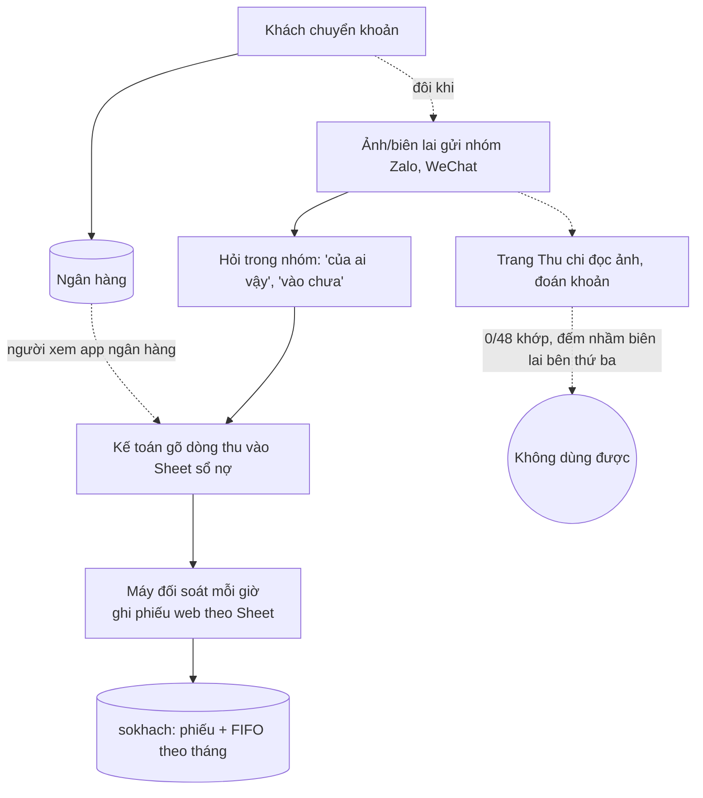
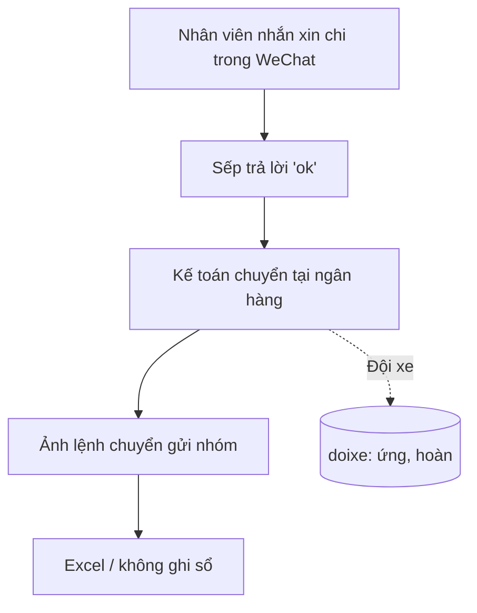
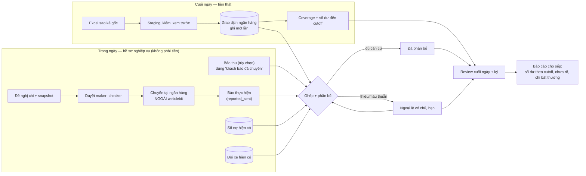
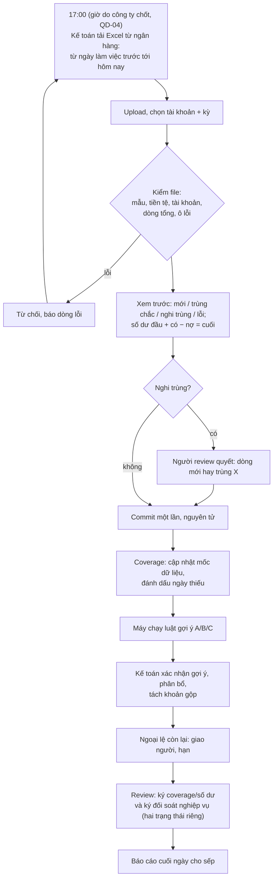
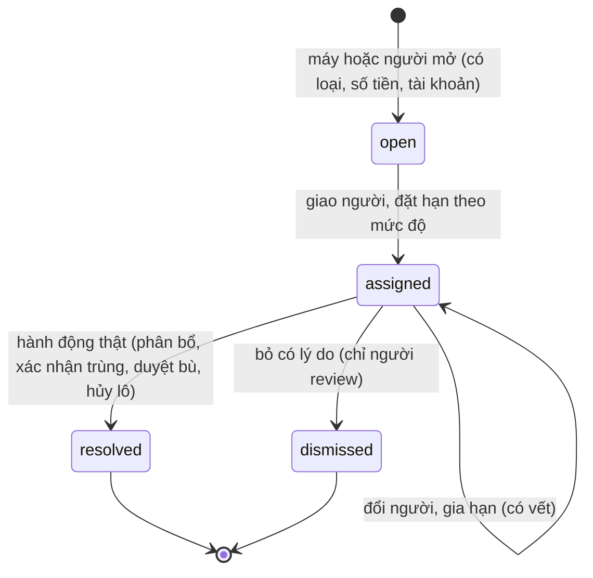

# B. Quy trình nghiệp vụ AS-IS và TO-BE

Trạng thái: AS-IS là **quan sát** (mã, tài liệu, số đo chỉ đọc 24/11/2026); TO-BE là **đề xuất** theo blueprint v3.0 đã được điều chỉnh ở [C](C-gap-analysis.md) và [F2](F2-adr.md), chưa chốt.

[← Mục lục](README.md) · Bằng chứng AS-IS: [A](A-audit-hien-trang.md) · Quy tắc: [D](D-business-rules.md)

Ràng buộc đã xác nhận (v3 §1): **không** API ngân hàng, webhook, RPA, dịch vụ đọc tài khoản, lưu mật khẩu/OTP; webdebit **không** khởi tạo hay chuyển lệnh thanh toán. Kế toán tải Excel sao kê gốc từ ngân hàng và upload mỗi cuối ngày làm việc.

## 1. Vai và trách nhiệm

| Vai | Ai (hiện tại, *suy luận*) | Việc chính TO-BE |
| --- | --- | --- |
| **Nhân viên** (người đề nghị, người phụ trách khách) | Nhân viên văn phòng, điều xe | Tạo đề nghị chi từ hồ sơ có sẵn; báo thu khi khách báo đã chuyển (tùy chọn); bổ sung chứng từ; xử lý ngoại lệ được giao |
| **Người duyệt** | Sếp; người duyệt thay khi sếp vắng (QD-12, QD-14) | Duyệt/từ chối đúng phiên bản đề nghị trên điện thoại; xem cảnh báo chi bất thường |
| **Kế toán** | Kế toán hiện đang chuyển tiền sau khi sếp duyệt | Chuyển tiền tại ngân hàng (ngoài webdebit), báo thực hiện; cuối ngày tải và nhập sao kê; phân bổ; mở ngoại lệ |
| **Người review** | Người khác kế toán; khi thiếu người: sếp review hằng tuần (QD-24) | Ký kết quả coverage/số dư và đối soát nghiệp vụ; tự tải sao kê định kỳ để so |
| **Team công nợ** | Người nhập Sheet sổ nợ | Xác minh tiền về của khách, xử lý "tiền về chưa phiếu / phiếu chưa thấy tiền" (P0-c) |
| **Quản trị kỹ thuật** | Claude (triển khai) + người được chủ doanh nghiệp giao | Dữ liệu chủ, cấp vai; **không** duyệt chi, không ghi dữ liệu tài chính (QD-06) |
| **Máy** | Luật gợi ý, máy canh | Gợi ý ghép (chỉ đề xuất ở P0), kiểm bất biến, báo sao kê cũ; không ký, không duyệt |

## 2. AS-IS

### 2.1 Thu cước



Điểm đau: sao kê không vào hệ thống; tiền về chưa ai gõ thì không ai biết; trả lắt nhắt phải cộng tay; khách trả hộ, khách tự trả hãng tàu dễ bị hiểu nhầm.

### 2.2 Chi và duyệt chi



Điểm đau: duyệt không gắn số tiền/người nhận cố định (không snapshot); không ai so lệnh thực tế với lời duyệt; chi không có duyệt chỉ lộ ra khi có người để ý; chi ngoài Đội xe không có sổ.

### 2.3 Tiền hàng khách Trung Quốc

USD "payment for goods" vào tài khoản công ty xuất khẩu → ảnh sao kê dán nhãn tay tên khách → chốt tỷ giá trong nhóm → Excel số dư từng khách (USD × tỷ giá → VND → chi hộ nhà cung cấp → còn lại; có khách âm = công ty ứng) → lệnh chi hộ theo lô, giao tiền mặt có biên bản giấy. Không có sổ nào trên web.

### 2.4 Biết tiền đang có

Hỏi trong nhóm ("tiền mặt cty còn …"), mở app ngân hàng từng tài khoản. Không có số dư có bằng chứng, không biết dữ liệu tới lúc nào.

## 3. TO-BE tổng thể: hai luồng, một lần ghi nhận tiền



Nguyên tắc: báo thu, đề nghị, duyệt, báo thực hiện **không** là tiền; chỉ giao dịch từ sao kê (và sổ quỹ ở P1) là tiền. Giao dịch luôn được ghi kể cả khi không có hồ sơ nào khớp.

## 4. TO-BE trong ngày

### 4.1 Báo thu (tùy chọn)

1. Khách báo đã chuyển (qua Zalo, điện thoại) → nhân viên mở sổ khách, bấm "Khách báo đã chuyển": số tiền, ngày, ghi chú mục đích/tháng (ADR-TIEN-14: dùng lại `contact_mark` loại `paid_claim`, gắn được tin Zalo).
2. Báo thu ở trạng thái **chờ xác minh**; không tạo phiếu, không giảm nợ; sổ khách hiện riêng "đang chờ xác minh".
3. Không bắt buộc: tiền về mà không có báo thu vẫn được ghi và xử lý ở cuối ngày.

### 4.2 Đề nghị chi → duyệt → chuyển → báo thực hiện

```mermaid
sequenceDiagram
  participant NV as Nhân viên
  participant W as webdebit
  participant S as Người duyệt
  participant KT as Kế toán
  participant NH as Ngân hàng (ngoài webdebit)
  NV->>W: Tạo đề nghị từ hồ sơ (chuyến, xe, container, nhà cung cấp)
  W-->>W: Sinh mã DCxxxx, khóa snapshot phiên bản 1
  W-->>S: Báo có đề nghị chờ duyệt (link nội bộ)
  S->>W: Duyệt phiên bản 1 (không được là người đề nghị)
  NV->>W: Sửa số tiền hoặc người nhận
  W-->>W: Phiên bản 2, duyệt cũ mất hiệu lực
  S->>W: Duyệt phiên bản 2
  KT->>NH: Kiểm số dư, lập lệnh, nội dung có mã DCxxxx, duyệt hai cấp nếu có
  KT->>W: Báo thực hiện: số tiền, tài khoản, giờ, mã giao dịch nếu có (có thể nhiều lần)
  Note over W: reported_sent ≠ đã chi; chờ sao kê cuối ngày
```

Người nhận mới hoặc đổi tài khoản: xác minh độc lập ngoài kênh yêu cầu (gọi lại số đã biết) trước khi duyệt (QD-13). Lệnh lỗi hoặc bị trả lại: báo trạng thái, không xóa lịch sử.

### 4.3 Đội xe, tiền mặt, tiền khách

- **Đội xe:** giữ luồng hiện có (ứng, đợt hoàn, bảng kê). Giao dịch chi cho tài xế ở cuối ngày được phân bổ vào đích `fleet` tham chiếu dòng ứng/hoàn đã có, **không** tạo bản ghi ứng thứ hai.
- **Tiền mặt (P1):** sổ quỹ là một tài khoản loại `cash`, phiếu quỹ có chứng từ, kiểm quỹ cuối ngày có giao dịch. Rút quỹ là chuyển nội bộ, không là chi phí.
- **Tiền khách Trung Quốc (P1, sau cổng pháp lý QD-20):** P0 chỉ gắn nhãn `customer_funds_pending`, giữ nguyên tệ, không tự phân bổ; không đưa tài khoản USD tiền hàng vào P0.

## 5. TO-BE cuối ngày (EOD)



**SOP cuối ngày (đề xuất, ~20–40 phút cho một tài khoản — *suy luận*, đo ở Discovery):**

1. Tải sao kê **gốc** từ ngân hàng (không mở rồi lưu lại bằng Excel; ADR-TIEN-17), kỳ gồm ngày làm việc trước để bắt giao dịch sau cutoff, cuối tuần, ngày nghỉ.
2. Upload; đọc bảng xem trước; xử lý dòng lỗi (tải lại file) và nghi trùng (quyết từng dòng).
3. Commit; kiểm thẻ tài khoản: "dữ liệu tới …", chênh số dư = 0, không ngày thiếu.
4. Mở Đối soát cuối ngày: xác nhận gợi ý mức A/B; phân bổ khoản biết rõ; khoản chưa rõ để nguyên `unidentified` và mở ngoại lệ.
5. Ghép chi với đề nghị/báo thực hiện; chi không có duyệt, sai người nhận, vượt số → ngoại lệ cho người duyệt.
6. Ký "coverage + số dư"; ký "đối soát nghiệp vụ" (có thể còn ngoại lệ mở, ghi rõ số lượng).
7. Báo cáo cuối ngày tự sinh cho sếp: thu/chi đã xác nhận, chuyển nội bộ tách riêng, số dư theo cutoff, chưa rõ, báo thu chưa thấy tiền, báo chi chưa thấy tiền, chi bất thường, ai xử lý, hạn.

**Cutoff và giao dịch ngoài giờ:** số dư hiển thị là "theo sao kê tới [mốc ngân hàng ghi trong file]", không gọi là số dư cuối ngày 24h; file chỉ có ngày thì không tự suy ra giờ. Ngày không upload hoặc không có bằng chứng "không phát sinh" → đánh dấu thiếu, không suy ra "không có giao dịch". Giao dịch muộn rơi vào ngày đã ký → mở lại có lý do, có vết.

## 6. Điểm duyệt và điểm ký

| Điểm | Ai | Căn cứ | Không được |
| --- | --- | --- | --- |
| Duyệt đề nghị chi (từng phiên bản) | Người duyệt có thẩm quyền theo ngưỡng (QD-12) | Snapshot số tiền, người nhận, tài khoản, mục đích, chứng từ | Tự duyệt đề nghị của mình; duyệt bù biến thành duyệt trước |
| Xác minh người nhận mới/đổi tài khoản | Người duyệt hoặc người được giao, khác người đề nghị | Gọi lại qua kênh đã biết, ghi kết quả | Xác minh bằng chính kênh gửi yêu cầu |
| Quyết dòng nghi trùng trước commit | Người review import | Dòng gốc, chuỗi số dư, file cũ | Tự bỏ dòng |
| Ký coverage + số dư | Người review | Chênh = 0, đủ ngày | Ký khi còn dòng lỗi/nghi trùng |
| Ký đối soát nghiệp vụ | Người review | Danh sách ngoại lệ còn mở | Ép phân loại để đóng ngày |
| Gỡ cờ chi chưa duyệt | Người duyệt (duyệt bù có lý do) | Hồ sơ, lý do | Kế toán chuyển tiền tự gỡ |
| Hủy lô, mở lại ngày đã ký | Người review | Lý do bắt buộc | Sửa im lặng |
| Ghi phiếu thu sổ nợ từ ngân hàng (P0-c, sau QD-16) | Kế toán (phân bổ) → hàm ghi phiếu hiện có | Giao dịch thật + phân bổ hợp lệ + khóa lặp | Ghi khi máy theo Sheet vẫn đang ghi phiếu cho cùng sổ |

## 7. Xử lý ngoại lệ



| Ngoại lệ | Người xử lý đề xuất | Hạn đề xuất (QD-24) |
| --- | --- | --- |
| Tiền vào chưa rõ khách (`unidentified`) | Team công nợ / người phụ trách khách | 2 ngày làm việc |
| Biết khách, chưa rõ mục đích (`unapplied`) | Người phụ trách khách | 2 ngày làm việc |
| Báo thu chưa thấy tiền | Người tạo báo thu; kế toán kiểm cutoff | Theo dõi tới 3 ngày làm việc |
| Báo đã chi chưa thấy trên sao kê | Kế toán (kiểm lệnh, cutoff; không tự chuyển lại) | 1 ngày làm việc |
| Chi không duyệt, trước duyệt, sai người nhận, vượt số | Người duyệt (điều tra, duyệt bù có lý do) | 1 ngày làm việc |
| Một đề nghị nhiều lệnh, nghi chi trùng | Kế toán + người duyệt | 1 ngày làm việc |
| Nghi trùng dòng import, thiếu kỳ | Người review import | Trước khi ký coverage |
| Chênh số dư | Kế toán + người review | Trước khi ký coverage |
| Khác pháp nhân, tiền tệ | Kế toán → chủ doanh nghiệp | 5 ngày làm việc |

Ngoại lệ không tự đóng khi sang ngày; mọi đổi trạng thái có vết; cảnh báo là dấu hiệu cần xác minh, không là kết luận gian lận.

## 8. Thao tác được thay, thao tác giữ

| Hôm nay | TO-BE | Bỏ được khi |
| --- | --- | --- |
| Nhắn xin chi trong WeChat, sếp trả lời "ok" | Đề nghị + duyệt trên điện thoại | P0-b qua cổng; ngày áp dụng do chủ doanh nghiệp chốt |
| Hỏi "khoản này vào chưa", "của ai vậy" | Thẻ tài khoản và danh sách chưa rõ sau khi nhập sao kê | P0-a qua cổng |
| Hỏi số dư trong nhóm | Thẻ số dư theo cutoff | P0-a qua cổng |
| Gõ dòng thu vào Sheet sổ nợ | **Giữ** tới quyết định chuyển hẳn ([`CHUYEN-HAN-01`](../../docs/decisions/chuyen-han-01.md)); sau đó một nguồn ghi (QD-16) | P0-c + QD-16 |
| Excel số dư khách Trung Quốc | **Giữ** tới P1 | P1 qua cổng |
| Ảnh lệnh chuyển gửi nhóm | Báo thực hiện trong đề nghị (ảnh đính kèm tùy chọn) | P0-b qua cổng |

Không thêm lớp báo cáo bắt buộc: báo thu tùy chọn; đề nghị chi thay tin nhắn xin chi; báo thực hiện thay ảnh gửi nhóm.
