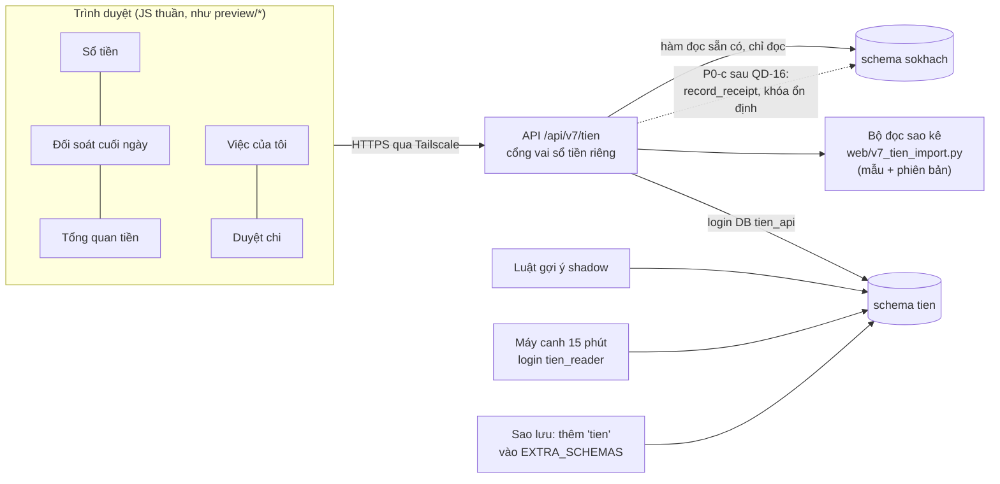
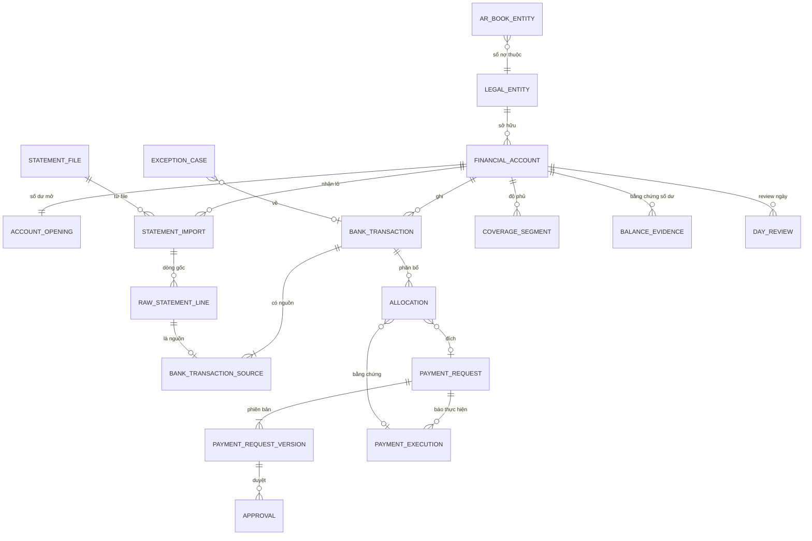
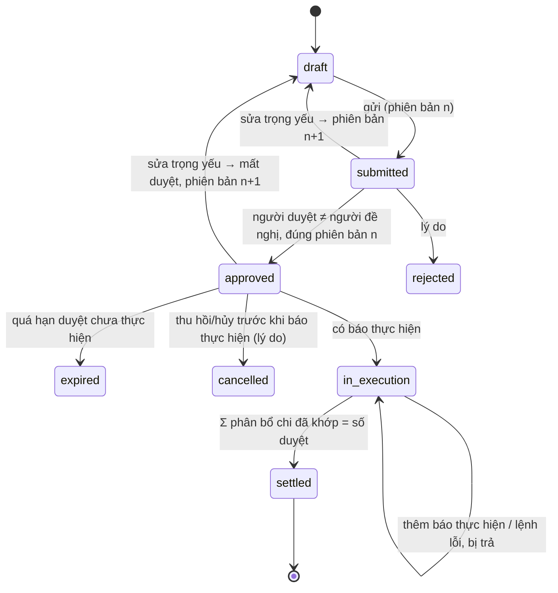

# F1. Kiến trúc kỹ thuật (Technical Architecture)

Trạng thái: **ĐỀ XUẤT** (Claude, 24/11/2026). Phác thảo logic để duyệt, **không** phải DDL để chạy; migration viết sau khi các quyết định chặn có người chốt, theo khuôn `sokhach` ([A §5](A-audit-hien-trang.md#5-thành-phần-tái-sử-dụng)). Đã sửa 12 điểm do review độc lập tìm thấy ở bản trước (ghi "sửa sau review").

[← Mục lục](README.md) · ADR: [F2](F2-adr.md) · PRD: [E](E-prd-p0.md) · Quy tắc: [D](D-business-rules.md)

## 1. Nguyên tắc

1. **Một nguồn tiền:** giao dịch ngân hàng (và sổ quỹ ở P1) là nơi duy nhất trả lời "tiền đã đi/về chưa". Hồ sơ nghiệp vụ không bao giờ cộng vào số dư xác nhận.
2. **Không ghi `sokhach` ở P0-a, P0-b;** P0-c chỉ ghi qua hàm hiện có với khóa lặp ổn định, sau QD-16.
3. **Tính ở SQL, trình duyệt chỉ hiển thị** (như sổ nợ hiện tại).
4. **Một schema mới `tien`** cùng DB, không khóa ngoại sang `sokhach`, DB login riêng.
5. **Không phụ thuộc mới** trừ khi QD-07 bắt buộc (bộ đọc `.xls`).

## 2. Thành phần



Danh tính dùng đường Tailscale hiện có ([A §6](A-audit-hien-trang.md#6-danh-tính-quyền-api)); route `/api/v7/tien` có cổng riêng: kiểm vai sổ tiền từ bảng `access_grant`, **từ chối** peer chỉ-đọc (bot Zalo), không dựa vào vai quản trị của QUYEN-01 (sửa sau review).

## 3. Mô hình dữ liệu logic



```text
tien.currency              code PK · minor_unit (VND 0, USD 2, CNY 2)
tien.legal_entity          id · code UNIQUE · name · status
tien.financial_account     id · legal_entity_id · kind {bank,cash} · bank_code · account_last4 · account_hmac
                           · currency · holder {company,personal} · statement_template (tên@phiên bản) · status
                           · version (khóa đồng thời) · created_event
                           UNIQUE (legal_entity_id, account_hmac, currency); không đổi pháp nhân/tiền tệ sau tạo
tien.account_opening       account_id PK · as_of · amount_minor · evidence_note · created_event           -- chỉ thêm
tien.ar_book_entity        customer_id (sokhach) · legal_entity_id · created_event                         -- ánh xạ sổ nợ (QD-17)
tien.access_grant          login · role · legal_entity_id · account_id NULL · created_event · revoked_event
tien.statement_file        id · account_id · sha256 · byte_size · content bytea (bảo vệ theo QD-08) · created_event
tien.statement_import      id · account_id · file_id · template · period_from · period_to · opening_minor NULL
                           · closing_minor NULL · last_day_complete bool · preview_account_version
                           · counts · status {draft,validated,committed,rejected,voided} · reason · events
tien.raw_statement_line    id · import_id · line_no · cells jsonb (chữ như file) · line_hash          -- chỉ thêm, quyền hẹp
tien.bank_transaction      id · account_id · source_family · currency · direction {in,out} · amount_minor > 0
                           · booking_date · value_date NULL · bank_ref NULL · description (quyền hẹp)
                           · counterparty_hmac NULL · counterparty_last4 NULL · balance_after_minor NULL
                           · fingerprint · version · voided_event NULL · created_event
tien.bank_transaction_source  bank_transaction_id · import_id · raw_line_id · role {origin,duplicate_confirmed}
                           -- giao dịch còn hiệu lực khi còn ≥ 1 nguồn thuộc lô chưa hủy (BR-IM13)
tien.coverage_segment      account_id · from_date · to_date · opening_minor · closing_minor · import_id
                           · last_day_complete                                                         -- suy từ lô đã commit
tien.balance_evidence      id · account_id · as_of_date · amount_minor · source {file,bank_pdf,bank_app}
                           · entered_by · created_event                                                -- người khác người nhập (BR-DC4)
tien.allocation            id · bank_transaction_id · target_kind · target_ref jsonb · amount_minor > 0
                           · evidence jsonb (contact_mark_id?, payment_execution_id?) · rule_id NULL · rule_version NULL
                           · created_event · superseded_event NULL · reason NULL
tien.payment_request       id · code UNIQUE · legal_entity_id · paying_account_id · requester · status · current_version
tien.payment_request_version  request_id · version_no · amount_minor · currency · payee_name · payee_account_hmac
                           · payee_last4 · purpose · category · obligation_refs jsonb · needed_on · evidence
                           · snapshot_hash · created_event                                             -- bất biến
tien.approval              id · request_id · version_no · decision {approved,rejected,revoked} · approver
                           · reason NULL · expires_at · is_retroactive bool · created_event
tien.payee_verification    id · payee_account_hmac · method · result · verified_by · created_event
tien.payment_execution     id · request_id · version_no · amount_minor · paying_account_id · reported_at
                           · bank_ref NULL · status {reported_sent,failed,returned} · created_event
tien.exception_case        id · kind · severity · amount_minor · currency · account_id · ref jsonb · assignee
                           · due_on · status {open,assigned,resolved,dismissed} · resolution · events
tien.day_review            account_id · business_date · coverage_status · business_status · signed_by
                           · role_overlap bool · events                                                -- hai chữ ký riêng
tien.rule_suggestion       id · bank_transaction_id · rule_id · rule_version · level {A,B,C} · candidates · created_at
tien.event                 id · account_id NULL · kind · actor · actor_kind {human,machine} · at · before · after
                           · idempotency_key · role_overlap                                           -- chỉ thêm
tien.idempotency           scope · key · request_hash · result                                        -- chỉ thêm
```

**Không có bảng riêng** cho báo thu (dùng `sokhach.contact_mark`, ADR-TIEN-14), cho "reconciliation group/link" (gộp vào `allocation` + cột `evidence`, ADR-TIEN-05) và cho sổ cái (ADR-TIEN-01). Đích `target_kind` P0: `ar_book`, `customer_unapplied`, `ar_receipt` (P0-c), `payment_request`, `internal_transfer`, `internal_transfer_pending`, `cash_withdrawal`, `bank_fee`, `interest`, `customer_funds_pending`, `fleet`, `expense_category`, `other`.

## 4. Trạng thái

**Lô nhập**

```mermaid
stateDiagram-v2
  [*] --> draft: tải file
  draft --> validated: đọc + kiểm xong (ghi version tài khoản)
  draft --> rejected: lỗi mẫu/an toàn
  validated --> rejected: người bỏ (lý do)
  validated --> committed: commit dưới khóa, phân loại lại, version còn đúng
  validated --> validated: version tài khoản đổi → phải xem trước lại
  committed --> voided: hủy lô (lý do; chặn nếu giao dịch sẽ mất có phân bổ/ngày đã ký)
```



**Giao dịch vào** (suy ra từ phân bổ, không lưu cột): `unidentified` (không dòng nào) → `unapplied` (chỉ `customer_unapplied`) → `partial` (0 < Σ < số tiền) → `applied` (Σ = số tiền). **Giao dịch ra:** `unmatched` → `partial` → `matched`.

**Đề nghị chi**



Số tiền thực hiện và khớp tính từ `payment_execution` và `allocation`, không sửa tay. **Ngoại lệ:** `open → assigned → resolved | dismissed` ([B §7](B-quy-trinh-as-is-to-be.md#7-xử-lý-ngoại-lệ)). **Ngày review:** mỗi (tài khoản, ngày) có hai trạng thái độc lập `coverage_status ∈ {missing, unconfirmed, signed, reopened}` và `business_status ∈ {open, signed, reopened}`.

## 5. Hợp đồng API

### 5.1 `StatementLine v1` — đầu ra bộ đọc

Mẫu VCB thật chưa khảo sát; cột nào có thật chốt ở Discovery (QD-07). Không đoán.

| Trường | Kiểu | Bắt buộc | Quy tắc |
| --- | --- | --- | --- |
| `line_no` | số nguyên | có | Thứ tự trong file |
| `booking_date` | `YYYY-MM-DD` | có | Ngày ngân hàng in; không sau hôm nay (giờ VN); trong kỳ khai báo |
| `value_date` | ngày | không | Lưu riêng |
| `direction` | `in` \| `out` | có | Hai cột Có/Nợ cùng có số hoặc cùng trống → lỗi |
| `amount_minor` | chuỗi số nguyên > 0 | có | Đơn vị nhỏ nhất; VND có phần lẻ → lỗi; ô trống → lỗi |
| `currency` | ISO 4217 | có | Bằng tiền tệ tài khoản |
| `description` | chữ | không | Nguyên văn |
| `bank_ref` | chữ | không | Chỉ là khóa khi chứng minh ổn định |
| `balance_after_minor` | chuỗi số nguyên | không | Có thì kiểm liền mạch trong file; **không** dùng trong dấu vân |
| `counterparty_name`, `counterparty_account` | chữ | không | Tài khoản đổi ngay thành HMAC + 4 số cuối |

Cấp lô: `opening_minor`, `closing_minor` (nếu file có), `period_from`, `period_to`, `last_day_complete`, `template`, `file_sha256`. Đối chiếu ISO 20022 camt.053 chỉ là gợi ý đặt tên.

### 5.2 Route

Mọi POST theo khuôn hiện có: JSON, `Origin` đúng, `idempotency_key`, số tiền là chuỗi số nguyên, trường lạ bị từ chối.

| Route | Vai | Ghi chú |
| --- | --- | --- |
| `GET /api/v7/tien/accounts`, `/accounts/{id}/summary` | `tien_xem` | Số dư theo sao kê + mốc dữ liệu + ngày thiếu + trạng thái ký |
| `GET /tien/transactions`, `/transactions/{id}` | `tien_xem` (nội dung: `tien_nhap`, `tien_review`) | Nguồn, phân bổ, vết |
| `POST /tien/imports/preview` | `tien_nhap` | File base64, giới hạn riêng 4 MiB; lưu `preview_account_version` |
| `POST /tien/imports/commit` | `tien_nhap` | `expected_preview_hash`, quyết định nghi trùng; phân loại lại dưới khóa |
| `POST /tien/imports/reject`, `/imports/void` | `tien_nhap` / `tien_review` | Lý do bắt buộc |
| `POST /tien/allocations` | `tien_phan_bo` | Thay cả bộ; `expected_version`; lý do khi bỏ/đổi dòng |
| `POST /tien/balance-evidence` | `tien_review` | Người nhập khác người nhập lô (có cờ nếu trùng) |
| `POST /tien/days/sign-coverage`, `/days/sign-business`, `/days/reopen` | `tien_review` | Hai chữ ký riêng |
| `GET/POST /tien/exceptions…` (open, assign, close, dismiss) | `tien_phan_bo`, `tien_review` | Mở ngoại lệ là lệnh riêng |
| `POST /tien/payment-requests` (create, edit → version mới, submit, cancel) | `chi_de_nghi` | |
| `POST /tien/payment-requests/{id}/approve`, `/reject`, `/revoke` | `chi_duyet` | Kèm `version_no`; chặn tự duyệt |
| `POST /tien/payee-verifications` | `chi_duyet` | |
| `POST /tien/payment-executions` (report, mark failed/returned) | `tien_phan_bo` | |
| `GET /tien/export?account_id=&from=&to=` | `tien_review` | CSV, vô hiệu ô công thức |
| `POST /tien/admin/accounts`, `/admin/opening`, `/admin/grants` | `tien_quan_tri` | |

Ví dụ xem trước (số bịa):

```json
{"import_id": "41", "status": "validated", "template": "vcb-xlsx@1", "preview_account_version": "17",
 "counts": {"rows": 212, "new": 180, "duplicate": 30, "suspect": 1, "error": 1},
 "balance": {"opening_minor": "120000000", "expected_opening_minor": "120000000",
             "closing_minor": "98500000", "computed_closing_minor": "98500000", "chain_breaks": 0},
 "coverage": {"from": "2026-11-23", "to": "2026-11-24", "last_day_complete": false, "missing_days": []},
 "warnings": ["NOT_ORIGINAL_FILE"]}
```

Mã lỗi mới (thêm vào `ERRORS`): `TIEN_FORBIDDEN`, `ENTITY_SCOPE`, `READONLY_PEER`, `IMPORT_PARSE_ERROR`, `IMPORT_UNSAFE_FILE`, `IMPORT_HAS_ERRORS`, `IMPORT_SUSPECT_UNRESOLVED`, `IMPORT_PREVIEW_STALE`, `BALANCE_CHAIN_BROKEN`, `DUPLICATE_TARGET_INVALID`, `VOID_WOULD_LOSE_ALLOCATED`, `OVER_ALLOCATION`, `CURRENCY_MISMATCH`, `REASON_REQUIRED`, `STALE_VERSION`, `IDEMPOTENCY_CONFLICT`, `DAY_NOT_READY`, `SELF_APPROVAL`, `APPROVAL_VERSION_MISMATCH`, `APPROVAL_EXPIRED`, `EXECUTION_EXCEEDS_APPROVED`, `AR_POSTING_DISABLED`, `AR_REFERENCE_EXISTS`.

## 6. Bất biến tài chính

| # | Bất biến | Kiểm ở |
| --- | --- | --- |
| I-1 | Số dư tài khoản = số dư mở + Σ vào − Σ ra của giao dịch còn hiệu lực | Hàm đọc, máy canh |
| I-2 | Lô chỉ commit khi số dư đầu file = số dư sổ ở điểm phủ trước, và (nếu có) liền mạch trong file; gãy → từ chối | Commit |
| I-3 | Ngày chỉ ký coverage khi: liên tục, không thiếu ngày, không dòng lỗi/nghi trùng, chênh với bằng chứng ngân hàng = 0 | Ký |
| I-4 | Σ phân bổ hiệu lực ≤ số tiền giao dịch, cùng tiền tệ | Mỗi lệnh phân bổ, máy canh |
| I-5 | Mỗi dòng phân bổ truy được tới event tạo và event thay (khuôn `_check_allocations`) | Mỗi lệnh |
| I-6 | Mỗi giao dịch còn hiệu lực có ≥ 1 dòng nguồn ở lô chưa hủy; một dòng nguồn trỏ đúng một giao dịch | Commit, hủy lô |
| I-7 | Bảng chỉ thêm không bị UPDATE/DELETE ngoài cột trạng thái do hàm lệnh đổi sau khi đã ghi event | Trigger |
| I-8 | Giao dịch, phân bổ, đề nghị thuộc đúng một pháp nhân, một tiền tệ; không tổng nào cộng khác tiền tệ | Hàm, test |
| I-9 | P0-a, P0-b không đổi dữ liệu `sokhach` | Harness so dấu vân |
| I-10 | Mỗi lệnh ghi đúng một khóa lặp; cùng khóa khác nội dung bị từ chối | Hàm lệnh |
| I-11 | Duyệt gắn đúng phiên bản; phiên bản bất biến; người duyệt ≠ người đề nghị | Hàm duyệt |
| I-12 | Σ báo thực hiện không vượt số đã duyệt của phiên bản hiệu lực (vượt → từ chối hoặc ngoại lệ theo QD-12) | Hàm báo thực hiện |
| I-13 | Số dư xác nhận không bao giờ cộng báo thu, báo thực hiện, cam kết | Hàm đọc |
| I-14 | P0-c: mỗi (giao dịch, sổ khách) sinh nhiều nhất một phiếu; không bật đồng thời hai nguồn ghi cho một sổ | Hàm ghi, cấu hình |

## 7. Mô hình phân quyền

| Hành động | xem | nhap | phan_bo | review | de_nghi | duyet | quan_tri |
| --- | --- | --- | --- | --- | --- | --- | --- |
| Xem số dư, giao dịch đã che | ✓ | ✓ | ✓ | ✓ | — | ✓ | — |
| Xem dòng gốc, nội dung | — | ✓ | — | ✓ | — | — | — |
| Xem trước, commit lô | — | ✓ | — | — | — | — | — |
| Phân bổ, báo thực hiện | — | — | ✓ | — | — | — | — |
| Quyết nghi trùng, ký ngày, mở lại, hủy lô | — | — | — | ✓ | — | — | — |
| Tạo/sửa đề nghị của mình | — | — | — | — | ✓ | — | — |
| Duyệt, duyệt bù, gỡ cờ chi chưa duyệt | — | — | — | — | — | ✓ | — |
| Dữ liệu chủ, cấp vai | — | — | — | — | — | — | ✓ |

- **Phạm vi:** mỗi cấp vai gắn pháp nhân (và tùy chọn tài khoản); hàm SQL tự kiểm phạm vi, gọi thẳng bằng ID vẫn bị chặn.
- **Cặp xung đột:** tự duyệt (cấm tuyệt đối); người nhập ký coverage lô mình (cho phép có cờ khi thiếu người); người chuyển tiền gỡ cờ chi chưa duyệt (cấm); quản trị cấp vai cho chính mình (cấm, cần người thứ hai hoặc runbook).
- **Một nguồn vai:** bảng `access_grant` (có event); cờ môi trường chỉ bật/tắt module. Vai quản trị đầu tiên được tạo bằng bước runbook triển khai có ghi nhật ký và chủ doanh nghiệp xác nhận (sửa sau review).
- **DB login:** API sổ tiền dùng login `tien_api` (thành viên `tien_app`, chỉ EXECUTE); máy canh dùng `tien_reader`; không login nào khác có quyền ghi `tien`; agent vận hành không có login ghi `tien` (sửa sau review). DB vẫn tin người làm do API đặt vào biến phiên — giới hạn đã biết, bù bằng login riêng chỉ dịch vụ API dùng được (peer auth) và event + máy canh.

## 8. Idempotency và đồng thời

| Đối tượng | Khóa | Lặp lệnh |
| --- | --- | --- |
| Commit lô | Khóa dòng `financial_account` (`FOR NO KEY UPDATE`) + `preview_account_version` | Cùng khóa lặp → kết quả cũ; version đổi → `IMPORT_PREVIEW_STALE` |
| Cùng file | (tài khoản, `sha256`) | Trả lô cũ |
| Phân bổ | Khóa tài khoản + `bank_transaction.version` | Một người thắng, người kia `STALE_VERSION` |
| Đề nghị chi | Khóa dòng đề nghị + `current_version` | Duyệt mang `version_no`; lệch → `APPROVAL_VERSION_MISMATCH` |
| Báo thực hiện | Khóa dòng đề nghị | Kiểm I-12 dưới khóa |
| Ký ngày | Khóa tài khoản | Ký lặp trả kết quả cũ |
| Ghi phiếu sổ nợ (P0-c) | Khóa lặp `sokhach` = băm(mã giao dịch, mã sổ); `record_receipt` tự khóa sổ khách | Sập giữa hai DB transaction → chạy lại cùng khóa, `record_receipt` trả kết quả cũ, sổ tiền lưu liên kết |

Mọi lệnh: `idempotency(scope, key, request_hash, result)` như `sokhach.idempotency`; băm loại người làm và version để gửi lại sau `RESULT_UNKNOWN` không thành lệnh mới.

## 9. Vết (audit)

- `tien.event` chỉ thêm, `before`/`after` bắt buộc, CHECK nội dung tối thiểu theo loại (khuôn `schema:297-329`). Loại: `account_create`, `opening_set`, `grant`, `revoke`, `import_preview`, `import_commit`, `import_reject`, `import_void`, `allocation_set`, `balance_evidence`, `day_sign_coverage`, `day_sign_business`, `day_reopen`, `exception_open`, `exception_assign`, `exception_close`, `exception_dismiss`, `pr_create`, `pr_version`, `pr_submit`, `pr_approve`, `pr_reject`, `pr_revoke`, `pr_cancel`, `payee_verify`, `execution_report`, `execution_status`, `ar_post` (P0-c).
- `actor_kind` phân biệt người/máy; `role_overlap` đánh dấu trùng vai; tóm tắt tuần cho chủ doanh nghiệp đọc từ đây.
- Đọc dòng gốc và nội dung chuyển khoản: API ghi một dòng log (login, lúc, tài khoản, mã đối tượng; không nội dung) vì giao dịch đọc là chỉ-đọc.
- Máy canh kiểm event chỉ thêm như lưới an toàn hiện có.

## 10. Bảo mật dữ liệu và lưu trữ

- **Không lưu:** mật khẩu, OTP, token ngân hàng (không có kết nối nào).
- **Số tài khoản:** cột có cấu trúc chỉ giữ HMAC + 4 số cuối (khóa HMAC trong file môi trường trên `hao`). **Ngoại lệ có chủ đích:** file gốc và ô gốc chứa nguyên văn; bảo vệ theo QD-08 — phương án đề xuất: chỉ hàm của vai nhập/review đọc được, mã hóa mọi bản sao lưu (kể cả bản trên `hao`, hiện chưa mã hóa), log truy cập (sửa sau review).
- **An toàn file:** chỉ mẫu đã khai; giới hạn 4 MiB file, số mục zip, dung lượng giải nén; từ chối DOCTYPE/thực thể XML; không chạy macro, công thức, liên kết ngoài; `.xls` chỉ khi QD-07 chọn bộ đọc có kiểm soát.
- **Không ra ngoài:** nội dung chuyển khoản không vào model, log, bot; thông báo (nếu bật) chỉ số đếm + link nội bộ.
- **Repo public:** chỉ dữ liệu bịa; file mẫu test tự dựng theo cấu trúc đã che; `scripts/check-secrets.js` trước mọi push.
- **Lưu trữ:** thời hạn giữ file sao kê và dữ liệu theo chính sách kế toán (QD-08, QD-09); không xóa trong đường lùi; xóa chỉ bằng quyết định.

## 11. Vận hành

- **Cờ:** `WEBDEBIT_TIEN=off|shadow|on`, `WEBDEBIT_TIEN_CHI=off|on` (P0-b), `WEBDEBIT_TIEN_AR_POST` theo từng sổ (P0-c), loại trừ với máy ghi phiếu theo Sheet của sổ đó.
- **Máy canh:** I-1, I-4, I-6, I-7, I-12 mỗi 15 phút; sao kê cũ quá 2 ngày làm việc; ngoại lệ quá hạn. Báo qua healthchecks hiện có, không số tiền, không tên.
- **Sao lưu:** thêm `tien` vào `EXTRA_SCHEMAS` của `tools/v7_backup.py`; khôi phục thử có số dư khớp.
- **Triển khai:** migration theo [`DEPLOY-CLAUDE-01`](../../docs/decisions/deploy-claude-01.md) (sao lưu trước, `ON_ERROR_STOP`, kiểm sau triển khai, so tổng khách để chứng minh `sokhach` không đổi); mỗi migration có file lùi.
