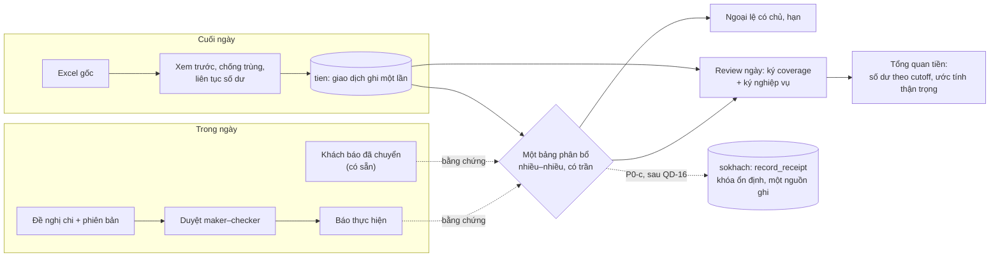

# Vận hành tài chính v3.0 — đánh giá kiến trúc và thiết kế P0

Trạng thái: **ĐỀ XUẤT** (Claude, 24/11/2026); **cập nhật cùng ngày: 11 câu chặn P0-a đã chốt** theo phương án đề xuất ([`SO-TIEN-01`](../../docs/decisions/so-tien-01.md)), kế toán còn xác nhận dữ kiện ở Discovery. Vòng đánh giá đầu: **không** code, không migration, không đổi dữ liệu, không tắt tính năng, không kết nối ngân hàng. Mọi quy tắc, ADR, phạm vi P0 chờ chủ doanh nghiệp và kế toán duyệt; câu đã chốt mới thành `docs/decisions/<id>.md`.

Đầu vào: blueprint **v3.0** `webdebit-financial-operations-v3.md` (24/11/2026, ngoài repo; ưu tiên cao nhất), v2.0 và "Thu chi tự sinh" (lịch sử); mã trên `main` tại `3c75c094`; sổ quyết định; tài liệu chính thức SAP, Oracle, Microsoft, Odoo, APQC, COSO đọc ngày 24/11/2026. Ràng buộc đã xác nhận: không API/webhook/RPA/dịch vụ đọc ngân hàng, không lưu mật khẩu/OTP, không chuyển tiền từ webdebit; kế toán tải Excel sao kê gốc và upload mỗi cuối ngày làm việc.

## Sáu kết luận

### 1. Điều đã tốt

- **v3 đúng hướng ở các điểm cốt lõi:** tách hồ sơ nghiệp vụ trong ngày khỏi tiền thật cuối ngày; "ticket không phải tiền, duyệt không phải chi"; coverage và số dư là lớp riêng, trung thực về cutoff; ghép mức A/B/C, shadow trước khi tự động; trạng thái `unidentified/unapplied/partial/applied`; số dư ước tính tách khỏi số dư xác nhận; đề nghị chi có snapshot, duyệt lại khi sửa, xác minh người nhận; tiền khách hoãn sau cổng pháp lý; bộ UAT 28 ca và KPI đặt tính đúng lên trước. Các điểm này khớp thông lệ SAP/Oracle/Microsoft/Odoo ([R §2](R-nghien-cuu-tham-chieu.md#2-đối-chiếu-theo-khái-niệm)).
- **Hệ thống hiện có có nền tốt để dùng lại:** khuôn lệnh idempotent (khóa + băm + phiên bản), vết chỉ thêm có kiểm theo loại, bất biến phân bổ kiểm cuối mỗi lệnh, hàm `SECURITY DEFINER` không cấp DML bảng, harness PostgreSQL có test đồng thời, lưới an toàn 15 phút, runbook triển khai có sao lưu; và "Khách báo đã chuyển" đã là một báo thu dùng được ([A §5](A-audit-hien-trang.md#5-thành-phần-tái-sử-dụng)).

### 2. Điều sai hoặc chưa đủ (trong v3 và trong bản đề xuất trước)

1. **v3 đặt ghi phiếu sổ nợ vào P0** nhưng chưa nói Sheet vẫn là sổ chính thức và máy đang ghi phiếu theo Sheet mỗi giờ, kể cả hủy rồi ghi lại khi Sheet sửa → ghi từ ngân hàng sẽ ghi công nợ hai lần nếu không có quyết định **một nguồn ghi** (QD-16).
2. **v3 nói "phân bổ vào công nợ", "chỉ định tháng"** nhưng sổ nợ webdebit phân bổ theo tháng, nợ cũ trước, tự tính lại; `record_receipt` không nhận tháng chỉ định → chỉ định tháng là đổi động cơ sổ nợ, không phải tính năng P0 (QD-19).
3. **Pháp nhân:** v3 đòi cô lập pháp nhân nhưng sổ nợ không có pháp nhân; bên phát hành debit note chọn ở trình duyệt (QD-17).
4. **USD:** debit note mặc định in tài khoản USD trong khi sổ nợ chỉ ghi VND → tài khoản thí điểm VND có thể không thấy phần lớn tiền cước (QD-18, QD-02).
5. **Định dạng file:** v3 chưa tính trường hợp VCB chỉ xuất `.xls` (thư viện chuẩn không đọc được) và rủi ro mở/lưu lại bằng Excel làm đổi file gốc (QD-07).
6. **Maker–checker** cho chi khác tinh thần V6/V6-DB của sổ nợ và khó với 2 login người; v3 chưa nói ai duyệt đề nghị của chính sếp (QD-06, QD-14).
7. **Quyền:** v3 yêu cầu "admin kỹ thuật không mặc định có quyền tài chính", nhưng hiện agent vận hành được tự ghi dữ liệu, đổi quyền và vai web fail-open (QD-06).
8. **Số dư ước tính đối xứng** (cộng thu đã báo) làm số đẹp hơn thực tế; nên thận trọng (QD-22).
9. **Bản đề xuất v2 trước đó có 12 lỗi thiết kế** do review độc lập tìm ra — commit không phân loại lại, hủy lô làm mất tiền thật, coverage theo ngày bỏ sót file giữa ngày, dấu vân có số dư sau, cổng quyền dựa vào vai quản lý… — đã sửa trong bộ này (ghi "sửa sau review" ở [F1](F1-kien-truc-ky-thuat.md), [F2](F2-adr.md), [D](D-business-rules.md)).
10. **Đề xuất SAO-KE-01** (đang ở `main`) băm chống trùng gồm thứ tự dòng → file chồng kỳ ghi hai lần; cần thay (C16).

### 3. Nên đơn giản hóa

- **Một bảng phân bổ** thay cho `ReconciliationGroup/Link` + `Allocation`: trạng thái ghép suy ra, không có hai nơi nói "đã khớp" (ADR-TIEN-05).
- **Báo thu dùng lại "Khách báo đã chuyển"**, không thêm màn hay bảng ở P0 (ADR-TIEN-14).
- **Năm màn mới** cho cả P0 (Sổ tiền, Đối soát cuối ngày, Tổng quan tiền, Việc của tôi, Duyệt chi) + sửa nhỏ Sổ khách ([E §6](E-prd-p0.md#6-màn-hình-p0-tối-thiểu-5-màn-mới--2-chỗ-sửa)).
- **Không sổ cái, không AR theo hóa đơn, không phải trả đầy đủ** ở P0; xuất CSV cho kế toán.
- **Một schema `tien`** cho cả tiền và kiểm soát chi, JS thuần, thư viện chuẩn Python.
- **Chia P0 thành P0-a/b/c** có cổng riêng thay một cổng lớn (ADR-TIEN-18).

### 4. Cần chủ doanh nghiệp và kế toán làm rõ

26 quyết định ở [I](I-decision-register.md); **11 câu chặn P0-a** (đã chốt 24/11/2026 theo phương án A, [`SO-TIEN-01`](../../docs/decisions/so-tien-01.md)): hướng v3 và cách chia (QD-01), tài khoản thí điểm (QD-02), cutoff (QD-04), phạm vi "không tiền chưa rõ chủ trên web" (QD-05), tách nhiệm vụ và agent (QD-06), định dạng file (QD-07), bảo vệ dữ liệu ngân hàng (QD-08), sổ kế toán chính thức (QD-09), số dư mở (QD-10), danh mục phân loại (QD-11), người ký review ngày (QD-24).

### 5. Kiến trúc đích khuyến nghị

Schema `tien` riêng cùng DB, không khóa ngoại sang `sokhach`, login DB riêng, cổng vai sổ tiền đóng mặc định; sổ tiền là sổ chi tiết quản trị, sổ cái pháp định ở phần mềm kế toán ([F1](F1-kien-truc-ky-thuat.md)).

### 6. Thứ tự triển khai

1. **Discovery** (không code): 11 câu P0-a đã chốt ([`SO-TIEN-01`](../../docs/decisions/so-tien-01.md)); nhận 1 tháng sao kê thật ngoài repo; đo cột, định dạng, mã giao dịch ổn định, tỷ lệ cước về USD, thời gian thao tác hiện tại.
2. **P0-a Sổ tiền nền:** nhập, xem trước, chống trùng, coverage, phân bổ thủ công, ngoại lệ, review ngày, thẻ số dư, vai, vết — shadow 1 tháng lịch sử rồi 4 tuần vận hành.
3. **P0-b Kiểm soát chi:** đề nghị, duyệt, báo thực hiện, ghép chi, ước tính thận trọng.
4. **P0-c Nối sổ nợ:** báo thu, đối chiếu chỉ đọc, luật shadow; ghi phiếu chỉ sau QD-16, từng sổ.
5. **P1:** thêm tài khoản và USD, quỹ tiền mặt, tiền khách (sau cổng pháp lý), phải trả, liên công ty. **P2:** dự báo, lãi lỗ.

Chi tiết cổng và lùi: [H](H-migration-rollout.md).

## Nguyên tắc không thương lượng → nơi đáp ứng

| Nguyên tắc | Nơi |
| --- | --- |
| Một giao dịch thật không bao giờ ghi hai lần | BR-G1, BR-IM5–IM8, ADR-TIEN-03, I-6 |
| Ticket không chứng minh tiền đã đi | BR-G2, ADR-TIEN-15, I-13 |
| Duyệt không phải là chi | BR-PR9–PR11, ADR-TIEN-15 |
| Tiền vào không tự là doanh thu; tiền ra không tự là chi phí | BR-G3, BR-AL4–AL8 |
| Không gán giao dịch chưa rõ cho khách tùy ý | BR-G4, BR-MA3 |
| Không ghép tự động chỉ vì số tiền bằng nhau | BR-G5, BR-MA1–MA4, UA-20 |
| Số dư xác nhận và tạm tính tách riêng | BR-G6, ADR-TIEN-16, I-13 |
| Số dư đã đối soát hiện đúng cutoff | ADR-TIEN-12, BR-IM11 |
| Lịch sử tài chính kiểm toán được | ADR-TIEN-02, F1 §9 |
| Sửa có kiểm soát, đảo được | BR-RV1–RV7, ADR-TIEN-05 |
| Tách pháp nhân và tiền tệ | ADR-TIEN-06, I-8 |
| Không đưa sao kê, thông tin khách cho AI bên ngoài | BR-G10, ADR-TIEN-10, F1 §10 |
| Không phá sổ nợ hiện có | BR-G11, ADR-TIEN-09, I-9, G §2.3 |
| Không làm quá mức | ADR-TIEN-01, 05, 14, 18; [E §2](E-prd-p0.md#2-phạm-vi) |

## Bộ tài liệu

| File | Nội dung (theo yêu cầu A–I) |
| --- | --- |
| [A-audit-hien-trang.md](A-audit-hien-trang.md) | A. Audit hệ thống: kiến trúc, năng lực, thành phần dùng lại, nợ kỹ thuật, rủi ro, bằng chứng file:dòng; trace một khoản thu, một khoản ứng/chi |
| [B-quy-trinh-as-is-to-be.md](B-quy-trinh-as-is-to-be.md) | B. Quy trình AS-IS/TO-BE, vai, điểm duyệt, SOP cuối ngày, ngoại lệ, sơ đồ Mermaid |
| [C-gap-analysis.md](C-gap-analysis.md) | C. 28 gap (hiện tại, mục tiêu, tham chiếu, tác động, rủi ro, ưu tiên, giải pháp); 16 xung đột với quyết định hiện hành; sổ rủi ro; phát hiện kiểm soát |
| [D-business-rules.md](D-business-rules.md) | D. Quy tắc báo thu, đề nghị và duyệt chi, nhập sao kê, ghép, phân bổ, ghi nhận, đảo, ngoại lệ, chốt ngày — gắn nhãn trạng thái |
| [E-prd-p0.md](E-prd-p0.md) | E. PRD P0: phạm vi, vai, yêu cầu chức năng/phi chức năng, màn, bất biến, tiêu chí nghiệm thu |
| [F1-kien-truc-ky-thuat.md](F1-kien-truc-ky-thuat.md) | F. Mô hình dữ liệu, ERD, trạng thái, API, phân quyền, idempotency, đồng thời, vết, bảo mật, lưu trữ |
| [F2-adr.md](F2-adr.md) | F. 18 ADR có lý do, tham chiếu, đánh đổi, phép kiểm |
| [G-uat-test.md](G-uat-test.md) | G. UAT U01–U28 của v3 + 21 ca từ audit; kế hoạch test tự động; KPI |
| [H-migration-rollout.md](H-migration-rollout.md) | H. Chọn tài khoản, số dư mở, thử 1 tháng, shadow, song song không ghi hai lần, cờ, cutover, lùi |
| [I-decision-register.md](I-decision-register.md) | I. 26 quyết định: câu hỏi, vì sao, phương án, ưu/nhược, khuyến nghị, có chặn không |
| [R-nghien-cuu-tham-chieu.md](R-nghien-cuu-tham-chieu.md) | Nghiên cứu: thông lệ / yêu cầu chính thức / mẫu nhà cung cấp / khuyến nghị |

Nhãn dùng chung: **quan sát** (có file:dòng) · **suy luận** (ghi rõ) · **đề xuất** (chờ chốt).

## Ngoài phạm vi vòng này

Không đọc DB thật, không đăng nhập `hao`, không mở sao kê thật, không đo hiệu năng; không đánh giá giao diện bản bấm thử THU-CHI-02 (nhánh `claude/thu-chi-ban-thu-1f3323`, dựng theo mô hình "một sổ" cũ — nên đối chiếu ADR-TIEN-05 trước khi dùng làm mẫu); không kết luận pháp lý, thuế, ngoại hối ([R §7](R-nghien-cuu-tham-chieu.md#7-yêu-cầu-chính-thức-tại-việt-nam--cần-kế-toán-pháp-lý-xác-nhận)).
